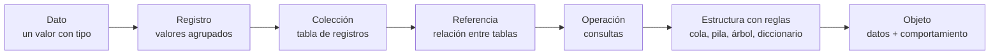
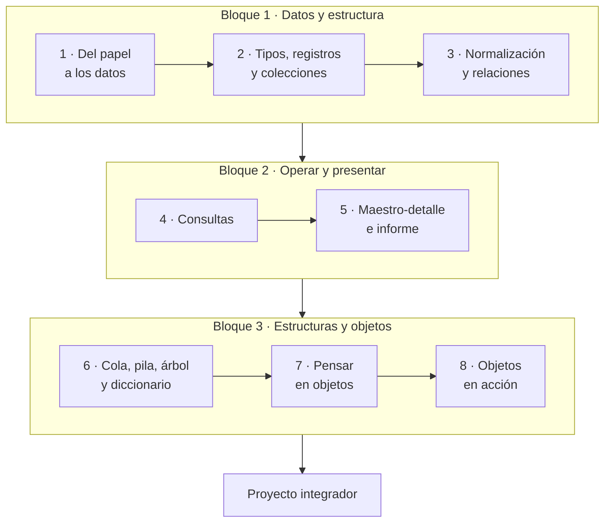

# Introducción a las Estructuras de Datos: guía del estudiante

Laboratorio: un sistema de facturación en LibreOffice Base · Versión del 13 de octubre de 2026

## Contenido

| Parte | Archivo |
| --- | --- |
| Presentación, precondiciones, mapa del curso y evaluación | Este archivo |
| Laboratorio 1 · Del papel a los datos | [lab01_del_papel_a_los_datos.md](lab01_del_papel_a_los_datos.md) |
| Laboratorio 2 · Tipos, registros y colecciones | [lab02_tipos_registros_y_colecciones.md](lab02_tipos_registros_y_colecciones.md) |
| Laboratorio 3 · Normalización y relaciones | [lab03_normalizacion_y_relaciones.md](lab03_normalizacion_y_relaciones.md) |
| Laboratorio 4 · Consultas | [lab04_consultas.md](lab04_consultas.md) |
| Laboratorio 5 · Maestro-detalle e informe | [lab05_maestro_detalle_e_informe.md](lab05_maestro_detalle_e_informe.md) |
| Laboratorio 6 · Cola, pila, árbol y diccionario | [lab06_cola_pila_arbol_diccionario.md](lab06_cola_pila_arbol_diccionario.md) |
| Laboratorio 7 · Pensar en objetos | [lab07_pensar_en_objetos.md](lab07_pensar_en_objetos.md) |
| Laboratorio 8 · Objetos en acción | [lab08_objetos_en_accion.md](lab08_objetos_en_accion.md) |
| Proyecto integrador | [proyecto_integrador.md](proyecto_integrador.md) |
| Glosario y referencia rápida | [glosario_y_referencia.md](glosario_y_referencia.md) |

## Presentación

En ocho sesiones de dos horas construirás un sistema de facturación completo en LibreOffice Base. Con él aprenderás las ideas centrales de las estructuras de datos: tipos, registros, colecciones, referencias, colas, pilas, árboles, diccionarios y objetos.

Cada sesión agrega al sistema una pieza que funciona y te deja una idea nueva. El recorrido es evolutivo: cada etapa conserva la anterior y le suma algo, hasta llegar a los objetos, que unen los datos con su comportamiento.

### Qué vas a construir

Al final tendrás una base de datos `Facturacion.odb` con clientes, productos organizados en un árbol de categorías, facturas con sus líneas y un historial de precios. Tendrá consultas de totales, un formulario de captura maestro-detalle, una factura imprimible y clases en LibreOffice Basic que protegen las reglas del negocio.

Es un sistema didáctico: no cumple los requisitos de facturación electrónica de ningún país.

### Al terminar el curso podrás

1. Explicar qué es una estructura de datos y elegir una según las operaciones que necesitas.
2. Elegir tipos de datos justificando dominio, tamaño y precisión.
3. Diseñar tablas con claves, índices y restricciones, y normalizarlas hasta la tercera forma normal.
4. Implementar relaciones con integridad referencial y explicar la clave foránea como una referencia.
5. Filtrar, transformar, agregar y unir colecciones con SQL.
6. Reconocer e implementar colas, pilas, árboles y diccionarios dentro de un sistema real.
7. Modelar un problema con pensamiento orientado a objetos (clases, responsabilidades y colaboraciones) e implementarlo con clases en LibreOffice Basic.

## Precondiciones

Necesitas una computadora con LibreOffice de escritorio instalado antes de la sesión 1. Base almacena las tablas en Firebird integrado; Calc ayuda a importar los CSV y Writer es el editor de formularios e informes. Si algo falla, avisa a tu instructor antes de la sesión.

### Equipo y software

| Requisito | Detalle | Cómo verificarlo |
| --- | --- | --- |
| Sistema operativo | Windows, Linux o macOS compatible con tu instalación de LibreOffice | Información del sistema |
| LibreOffice de escritorio | Instalación con Base, Calc, Writer y las bibliotecas de macros ScriptForge; usa la versión comprobada por el instructor | Ayuda → Acerca de LibreOffice; abre Base |
| Firebird integrado | El asistente de base nueva permite elegir Firebird integrado | Archivo → Nuevo → Base de datos |
| Java para informes | El generador de informes puede necesitar un JRE de la misma arquitectura que LibreOffice | Herramientas → Opciones → LibreOffice → Avanzado; en macOS, LibreOffice → Preferencias |
| Espacio local | 500 MB libres; carpeta personal `CursoED` con permisos de escritura | Administrador de archivos |
| Archivos del curso | `datos/` con seis CSV y `basic/` con los módulos UTF-8 | Paquete `kit_estudiante` |
| Navegador opcional | Para diagramas en [mermaid.live](https://mermaid.live); también puedes usar papel | Abre la página y prueba un diagrama |

Los menús se describen en español; su ubicación puede variar entre sistemas y versiones. No necesitas una cuenta de Microsoft ni una máquina virtual para este curso.

### Conocimientos previos

- Manejo básico del sistema operativo: carpetas, extensiones de archivo, copiar y pegar.
- Uso básico de una hoja de cálculo: filas, columnas y fórmulas simples.
- Programación básica en cualquier lenguaje: variables, condicionales, ciclos y funciones. La usarás en las sesiones 6, 7 y 8.
- Porcentajes y redondeo.

No necesitas experiencia previa con bases de datos ni con Base.

### Configuración antes de la sesión 1

- [ ] Crea `CursoED` dentro de tu carpeta personal y en disco local. Ejemplos: Windows `C:\Users\tu_usuario\CursoED`, Linux `/home/tu_usuario/CursoED`, macOS `/Users/tu_usuario/CursoED`.
- [ ] Copia dentro las carpetas `datos` y `basic` del kit del estudiante.
- [ ] Activa la visualización de extensiones de archivo en tu administrador de archivos.
- [ ] Abre Base y comprueba la opción Firebird integrado.
- [ ] Comprueba con el instructor el generador de informes y Java antes de necesitarlo en la sesión 5.

La ubicación de confianza para macros se configura en el laboratorio 1. Solo agrega la carpeta local del curso y usa sus archivos de código conocidos.

## Mapa del curso

El curso tiene tres bloques: primero das forma a los datos, luego los operas y presentas, y al final los proteges con estructuras y objetos. Cada sesión deja una tarea que se entrega antes de la siguiente.

| Sesión | Idea de estructuras de datos | Lo que construyes | Tarea |
| --- | --- | --- | --- |
| 1 · Del papel a los datos | Dato, información, entidad, atributo y registro | La base de datos local y la carpeta de macros de confianza y el primer modelo entidad-relación | Modelar un recibo de pago |
| 2 · Tipos, registros y colecciones | Tipos y precisión; la tabla como colección; búsqueda lineal frente a indexada | `tblClientes` y `tblProductos` con validaciones, índices y datos importados | Tabla de proveedores y experimento de búsqueda |
| 3 · Normalización y relaciones | Redundancia, formas normales, referencias e integridad | `tblCategorias`, `tblFacturas`, `tblDetalleFactura` y sus relaciones | Normalizar una tabla de pedidos |
| 4 · Consultas | Recorrer, filtrar, transformar, agregar y unir colecciones | Importes, subtotales, impuestos, totales y ventas por cliente | Ventas por producto y por mes |
| 5 · Maestro-detalle e informe | Jerarquía padre-hijo | Formulario de facturas con sus líneas y la factura imprimible | Informe de estado de cuenta |
| 6 · Cola, pila, árbol y diccionario | Estructuras con disciplina de acceso | Cola de cobranza, deshacer cambios de precio y árbol de categorías | Ruta y profundidad en el árbol |
| 7 · Pensar en objetos | Objeto, clase, responsabilidad, colaboración y encapsulamiento | Modelo de clases y diagrama de estados de la factura | Modelar pagos parciales |
| 8 · Objetos en acción | Clases, composición, invariantes y persistencia | Clases en LibreOffice Basic que emiten facturas respetando sus reglas | Proyecto integrador |

## Cómo trabajar en el laboratorio

Trabajarás siempre sobre una sola base de datos, `CursoED/Facturacion.odb`, que crece sesión a sesión. Al terminar cada sesión haz una copia de seguridad.

Antes de usar la consulta parametrizada de la sesión 4, habilita la sustitución de parámetros nombrados. Para hacerlo con macro, carga `modConstantes` y `modEstructuras` y ejecuta `EjecutarConfiguracionParametros`. El helper guarda `ParameterNameSubstitution = True` para que Base convierta parámetros como `:FechaInicial` a `?`. Guarda y cierra la base y todas sus ventanas, y vuelve a abrirla: una conexión que ya estaba abierta conserva la configuración anterior. También puedes activar «Reemplazar parámetros con nombre por “?”» en Editar → Base de datos → Configuración avanzada → Configuración especial, como indica ese laboratorio.

### Estructura de cada laboratorio

1. Objetivos: lo que podrás hacer al terminar.
2. Conceptos: la idea de estructuras de datos, con diagramas.
3. Paso a paso: instrucciones numeradas en Base, Calc o Writer.
4. Puntos de control: resultados que debes ver antes de seguir.
5. Tarea: se entrega antes de la sesión siguiente.
6. Autoevaluación: preguntas para comprobar tu comprensión.

### Recuadros

- **Concepto:** la idea teórica detrás de un paso.
- **Conexión:** cómo se llama esa idea en estructuras de datos o en programación.
- **Ojo:** un error frecuente y cómo evitarlo.
- **Captura sugerida:** lugar para una imagen de pantalla que tu instructor puede agregar con su versión de Base.

### Convenciones de nombres

| Objeto | Prefijo | Ejemplo |
| --- | --- | --- |
| Tabla | `tbl` | `tblFacturas` |
| Consulta | `qry` | `qryTotalesFactura` |
| Formulario | `frm` | `frmFacturas` |
| Subformulario | `sfrm` | `sfrmDetalleFactura` |
| Informe | `rpt` | `rptFactura` |
| Módulo estándar | `mod` | `modEstructuras` |
| Módulo de clase | `cls` | `clsFactura` |

Los nombres de objetos y campos van sin espacios, sin acentos y sin ñ, con mayúscula al inicio de cada palabra: `IdCliente`, `PrecioUnitario`. En Firebird, escribe los nombres de tablas y campos entre comillas dobles para conservar sus mayúsculas: `"tblFacturas"`, `"IdCliente"`. Las cadenas de texto SQL llevan comillas simples: `'Borrador'`.

### Copias de seguridad

- Guarda formularios, consultas y macros, guarda el `.odb` y cierra todas sus ventanas antes de copiarlo.
- Copia el archivo cerrado a `Facturacion_sesion01.odb`, `Facturacion_sesion02.odb`, etc. Conserva una copia fuera de la carpeta de trabajo.
- Si algo se daña, abre la última copia cerrada y repite solo los pasos de la sesión.

El `.odb` incluye el contenedor de Firebird integrado, formularios, consultas y macros. Copiarlo mientras está abierto puede producir una copia incompleta.

Las tareas son individuales. En la sesión 7 trabajarás en equipos de tres o cuatro personas.

## Evaluación

Tu calificación combina las tareas de laboratorio (50 %), el proyecto integrador (35 %) y la autoevaluación con participación (15 %). Tu instructor puede ajustar estos pesos.

| Componente | Peso | Qué se evalúa |
| --- | --- | --- |
| Tareas de las sesiones 1 a 7 | 50 % | Que funcione, que justifiques tus decisiones de diseño y que los diagramas sean correctos |
| Proyecto integrador | 35 % | Modelo de datos, modelo de objetos, implementación, pruebas y presentación |
| Autoevaluación y participación | 15 % | Preguntas al cierre de cada laboratorio y trabajo durante la sesión |

### Rúbrica de las tareas

| Criterio | Peso | Nivel excelente |
| --- | --- | --- |
| Funcionamiento | 40 % | Todo lo pedido funciona y pasa los puntos de control |
| Justificación | 30 % | Cada decisión (tipo, clave, relación, clase) tiene una razón explícita |
| Modelado | 20 % | Los diagramas Mermaid son correctos y coinciden con lo construido |
| Presentación | 10 % | Nombres según la convención, respuestas claras y entrega a tiempo |

### Entrega de cada tarea

Entrega tu `Facturacion.odb` con tu apellido en el nombre (por ejemplo `Facturacion_Perez.odb`) y un PDF breve con respuestas y diagramas. El plazo es el inicio de la sesión siguiente.

## Archivos que usarás

| Laboratorio | Archivos del paquete del curso |
| --- | --- |
| 1 · Del papel a los datos | Ninguno: la factura modelo está en la guía |
| 2 · Tipos, registros y colecciones | `datos/clientes.csv`, `datos/productos.csv`, `basic/modRegistros.bas` |
| 3 · Normalización y relaciones | `datos/factura_plana.csv`, `datos/categorias.csv`, `datos/facturas.csv`, `datos/detalle_factura.csv` |
| 4 · Consultas | Alternativa con macro: `basic/modConstantes.bas`, `basic/modEstructuras.bas`, para configurar parámetros nombrados |
| 5 · Maestro-detalle e informe | `basic/modConstantes.bas`, `basic/modEstructuras.bas`; escribes `modInterfaz` en clase |
| 6 · Cola, pila, árbol y diccionario | `basic/modConstantes.bas`, `basic/modEstructuras.bas` |
| 7 · Pensar en objetos | Ninguno: papel, tarjetas y mermaid.live |
| 8 · Objetos en acción | `basic/modConstantes.bas`, `basic/clsLineaFactura.bas`, `basic/clsFactura_plantilla.bas`, `basic/clsRepositorioFacturas.bas`, `basic/modPruebasObjetos.bas` |

Los datos de ejemplo son ficticios: 8 clientes, 15 productos, 11 categorías y 7 facturas con 16 líneas.

## Cómo cargar y ejecutar los módulos Basic

Los archivos del curso son texto UTF-8 con extensión `.bas`; las clases también son `.bas`. Se pegan en módulos de la biblioteca **Standard del documento**, para que viajen con `Facturacion.odb`. No los guardes en «Mis macros».

1. Abre `Facturacion.odb`. Elige Herramientas → Macros → Organizar macros → Basic (LibreOffice Basic).
2. Selecciona el documento `Facturacion.odb`, luego su biblioteca `Standard`. Si no aparece, usa Organizar → Bibliotecas → Nuevo y crea `Standard` en ese documento.
3. En Organizar → Módulos elige Nuevo y escribe el nombre del archivo sin `.bas`. **Excepción:** para `clsFactura_plantilla.bas`, crea el módulo **`clsFactura`**. No crees ambas clases a la vez.
4. Abre el archivo `.bas` con un editor de texto en UTF-8. Copia todo su contenido. En el editor Basic, elimina el ejemplo `Sub Main … End Sub` y pega el contenido completo, incluidas las líneas `Option` del principio.
5. Repite para los archivos que pide el laboratorio. Conserva los nombres: `New clsFactura` busca precisamente el módulo `clsFactura`.
6. Guarda desde el editor y desde Base. En el editor selecciona un procedimiento `Sub` sin argumentos y pulsa Ejecutar (F5); también puedes seleccionarlo en Herramientas → Macros → Ejecutar macro. Basic compila al ejecutar y señala la línea si hay un error.
7. Lee el resultado en los cuadros `MsgBox`. Para llamar funciones o pasar argumentos, crea una pequeña `Sub` de prueba; los laboratorios incluyen ejemplos.

Un módulo de clase empieza con `Option VBASupport 1`, `Option ClassModule` y `Option Explicit`. El modo `Option VBASupport 1` habilita las clases y el objeto `Err` para emitir errores personalizados con `Err.Raise`; sigue siendo código LibreOffice Basic. La base y sus controles se manejan con UNO/SDBC. Este modo no proporciona DAO ni `Implements`. Consulta la [ayuda oficial sobre módulos de clase](https://help.libreoffice.org/latest/es/text/sbasic/shared/classmodule.html) y el [objeto Err](https://help.libreoffice.org/latest/es/text/sbasic/shared/ErrVBA.html).

> **Ojo:** si las macros se bloquean, revisa la carpeta de confianza y vuelve a abrir el documento; no reduzcas globalmente la seguridad. Los ejemplos se ejecutan desde el `.odb` abierto. En eventos del formulario Writer, el kit obtiene una conexión aislada de Base para sus transacciones. Guarda la edición antes y recarga el formulario después, como hace el manejador de emisión de la sesión 8.
