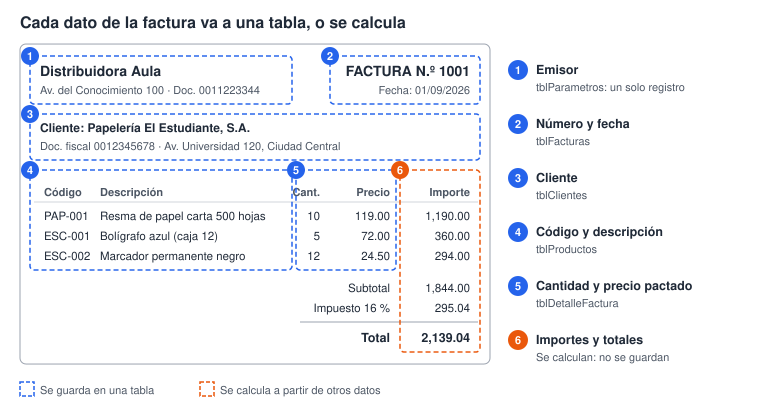
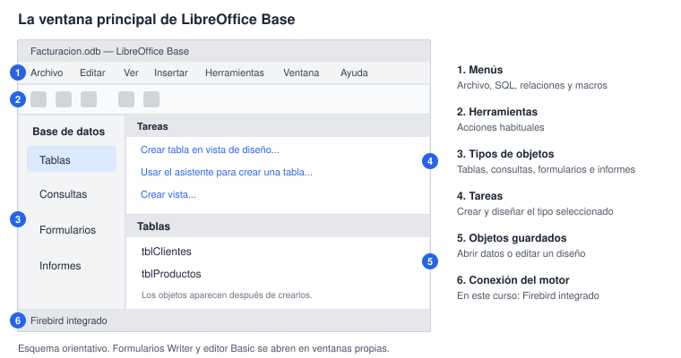
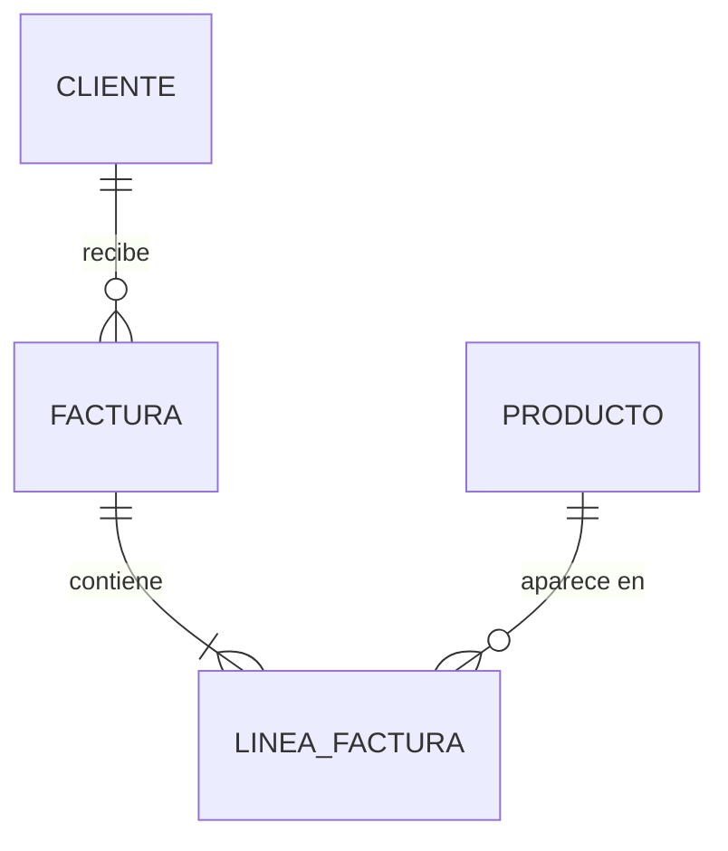
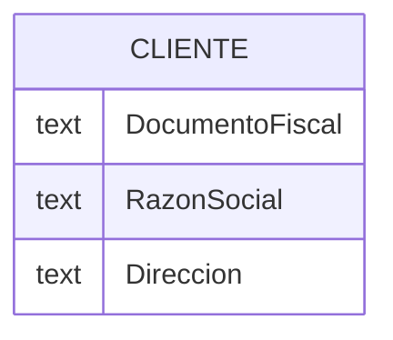

# Laboratorio 1 · Del papel a los datos

En esta sesión conviertes una factura en papel en un modelo de datos y creas la base de datos donde vivirá el sistema.

## Objetivos

- Distinguir dato, información y estructura de datos.
- Identificar entidades, atributos y registros en un documento real.
- Separar los datos que se guardan de los que se calculan.
- Crear una base Firebird integrada y reconocer los objetos y las bibliotecas de Basic en LibreOffice.
- Dibujar un primer modelo entidad-relación en Mermaid.

## Conceptos

**Dato, información y estructura.** Un dato es un valor aislado: `119.00`. Se vuelve información cuando sabes qué significa: el precio de una resma de papel el 1 de septiembre. Una estructura de datos es la forma de organizar muchos datos para guardarlos, buscarlos, relacionarlos y cambiarlos con eficiencia.

**Entidad, atributo y registro.** Una entidad es algo del problema sobre lo que guardas datos: un cliente, un producto, una factura. Sus atributos son las características que te interesan: razón social, precio, fecha. Un registro agrupa los valores de una sola ocurrencia: el cliente 1 con todos sus datos.

> **Conexión:** un registro es lo que en programación llamas estructura: `struct` en C o `Type` en LibreOffice Basic. En la sesión 2 lo verás en código.

**Guardar o calcular.** El importe de una línea es la cantidad por el precio. Si lo guardas y alguien corrige la cantidad, el importe queda mal. Regla práctica: guarda los datos de origen y calcula los derivados.

### La factura modelo

## Paso a paso

### Parte A · Analiza la factura, sin computadora (25 min)

1. Haz una lista de todos los datos que aparecen en la factura modelo.
2. Clasifica cada dato en una tabla como esta, en tu cuaderno:

| Dato | Ejemplo | Entidad | ¿Se guarda o se calcula? |
| --- | --- | --- | --- |
| Número de factura | 1001 | Factura | Se guarda |
| Razón social | Papelería El Estudiante, S.A. | Cliente | Se guarda |
| Importe de la línea | 1,190.00 | Línea de factura | Se calcula |

3. Agrupa los datos por entidad. Deberían salirte cuatro principales: Cliente, Producto, Factura y Línea de factura.
4. Discute con tu compañero qué hacer con los datos del emisor, que se repiten idénticos en todas las facturas.
5. Para cada entidad, elige el atributo que distingue un registro de todos los demás. Ese atributo es un candidato a clave.

### Parte B · Prepara LibreOffice Base (20 min)

1. Crea una carpeta local `CursoED` con `datos` y `basic`. Puede estar en tu carpeta de usuario de Windows, macOS o Linux. Copia allí los CSV y las fuentes de `kit_estudiante`; anota su ruta. El curso usará rutas relativas a esta carpeta.
2. Abre LibreOffice y elige Archivo → Nuevo → Base de datos. En el asistente, selecciona **Crear una nueva base de datos** y **Firebird integrado**. No elijas una conexión a una hoja de cálculo: sirve para leer datos, pero no para crear estas tablas y restricciones.
3. En el último paso, puedes desmarcar «Registrar la base de datos»; los ejemplos acceden al documento abierto. Marca abrir para editar, termina y guarda como `CursoED/Facturacion.odb`.
4. Comprueba que la ventana indica Firebird integrado como conexión. Anota la versión de LibreOffice en Ayuda → Acerca de. El SQL de este curso se prepara para Firebird 3, integrado en la instalación validada; si tu motor es otro, consulta al instructor antes de cambiar el esquema.
5. Para las macros del curso, abre Herramientas → Opciones → LibreOffice → Seguridad → Seguridad de macros → Fuentes de confianza → Ubicaciones de archivos de confianza. En macOS, Opciones se encuentra en LibreOffice → Preferencias. Agrega solamente tu carpeta local `CursoED`, mantén el nivel de seguridad y vuelve a abrir el documento. Sigue las políticas del aula si esta opción está administrada.
6. Comprueba que Base y el editor de Basic abren. Para los asistentes y el Diseñador de informes, el aula debe disponer también de un JRE compatible con la arquitectura de LibreOffice, seleccionado en LibreOffice → Avanzado. Firebird integrado no exige Java para ejecutar su SQL; el Diseñador de informes sí lo requiere.

> **Captura sugerida:** ventana de Base con `Facturacion.odb` y Firebird integrado. La base se construye en clase; el kit no trae una base binaria terminada.

### Parte C · Recorre la interfaz (15 min)

| Objeto | Para qué sirve | Lo usarás en |
| --- | --- | --- |
| Tabla o vista de Firebird | Guarda filas; una vista conserva una definición SQL y calcula al consultarla | Sesiones 2–4 |
| Consulta guardada de Base | Conserva una pregunta, criterios y parámetros | Sesión 4 |
| Formulario | Documento Writer con controles ligados a datos | Sesión 5 |
| Informe | Diseño que genera un documento Writer para imprimir | Sesión 5 |
| Biblioteca y módulo Basic | Guarda procedimientos y clases; se abre en Herramientas → Macros → Organizar macros → Basic | Sesiones 2, 6 y 8 |

1. Selecciona Tablas, Consultas, Formularios e Informes en la columna izquierda. Las tareas disponibles cambian arriba a la derecha y los objetos guardados aparecen abajo.
2. Observa que abrir una tabla muestra filas; editarla permite ver campos y tipos. En formularios de Writer, activa **Modo diseño** para modificar los controles y desactívalo para trabajar con los datos.
3. Abre el organizador de Basic e identifica las bibliotecas del documento `Facturacion.odb` y «Mis macros». El curso guardará su código en el documento, según `00_inicio.md`, para que la base y sus macros viajen juntas.

**Estructura y contenido.** Base es la interfaz. Firebird almacena y protege los datos. El archivo `.odb` reúne la base integrada, consultas y documentos; un formulario Writer y un resultado de informe son objetos distintos aunque ambos se dibujen en páginas. Guarda y cierra completamente Base antes de copiar el `.odb`: una copia con la base todavía abierta puede omitir cambios recientes.

### Parte D · Tu primer modelo entidad-relación (25 min)

1. Abre [mermaid.live](https://mermaid.live) o usa papel.
2. Copia este inicio. Cada línea une dos entidades y dice cuántos registros de un lado corresponden al otro.

3. Lee los extremos: `||` significa exactamente uno, `o{` cero o muchos y `|{` uno o muchos. Un cliente recibe cero o muchas facturas; una factura contiene una o muchas líneas.
4. Agrega los atributos de tu tabla de análisis a cada entidad, con esta forma:

5. Guarda la base, cierra los formularios y Base y copia `Facturacion.odb` como `Facturacion_lab01.odb` en una carpeta `copias`. Reabre la copia para comprobarla y continúa trabajando con el original.

## Puntos de control

- [ ] Tu tabla de análisis clasifica al menos 15 datos.
- [ ] Tu carpeta `CursoED` contiene `datos`, `basic` y `Facturacion.odb`; identificaste dónde guardar las macros.
- [ ] `Facturacion.odb` abre con Firebird integrado y has anotado la versión instalada.
- [ ] Tu diagrama tiene 4 entidades, 3 relaciones y los atributos de cada entidad.

## Tarea 1 · Modela un recibo de pago

Cuando un cliente paga, la empresa le entrega un recibo con número, fecha, cliente, forma de pago (efectivo, tarjeta o transferencia) y monto recibido. El recibo lista las facturas que ese pago cubre y el monto aplicado a cada una.

Entrega:

1. La tabla de análisis de los datos del recibo.
2. El diagrama entidad-relación en Mermaid, con atributos y cardinalidades.
3. Una respuesta breve: ¿un pago puede cubrir varias facturas? ¿Una factura puede pagarse con varios recibos? ¿Qué tipo de relación resulta y cómo la representarías?

## Autoevaluación

1. ¿Por qué el total de una factura no debería guardarse como un dato más?
2. ¿Qué diferencia hay entre una entidad y un registro?
3. ¿Qué diferencia hay entre el motor Firebird, la ventana de Base y un formulario Writer?
4. En `CLIENTE ||--o{ FACTURA`, ¿qué significa cada extremo?

## Referencias de esta sesión

[Primeros pasos con Base](https://books.libreoffice.org/en/GS74/GS7408-GettingStartedWithBase.html) y [requisitos del Diseñador de informes](https://help.libreoffice.org/latest/es/text/sdatabase/rep_main.html).
