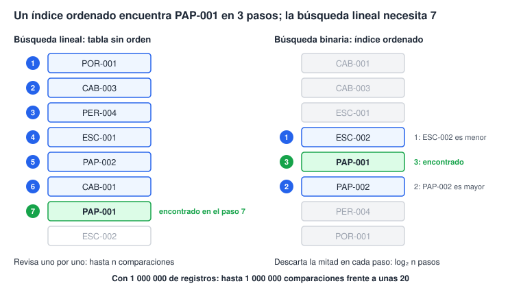

# Laboratorio 2 · Tipos, registros y colecciones

Hoy creas las tablas de clientes y productos eligiendo cada tipo con una razón, cargas los datos y comparas dos formas de buscar.

## Objetivos

- Elegir el tipo de cada atributo según su dominio, tamaño y precisión.
- Crear tablas, claves, valores predeterminados y restricciones en HSQLDB, y reconocerlos en el diseño de Base.
- Explicar una tabla como una colección de registros y su clave como identidad.
- Importar CSV con Calc controlando fechas, decimales y codificación.
- Comparar la búsqueda lineal con la búsqueda binaria sobre datos ordenados.

## Conceptos

**Tipo de dato.** Define los valores posibles, la precisión y las operaciones. La etiqueta que aparece en Base puede estar traducida; en el SQL usamos el nombre del motor.

| Tipo SQL de HSQLDB | Qué guarda | Uso en el curso |
| --- | --- | --- |
| `VARCHAR(n)` | Texto de longitud variable, limitado a n caracteres | Nombres, documentos, códigos y teléfonos |
| `LONGVARCHAR` | Texto extenso (Memo en Base) | Observaciones |
| `INTEGER` | Entero de 32 bits | Cantidades y claves |
| `DOUBLE PRECISION` | Número en coma flotante binaria | Experimento de precisión y medidas aproximadas |
| `DECIMAL(18,4)` | Decimal exacto, hasta 18 dígitos, cuatro decimales | Precio y precio unitario |
| `DECIMAL(9,4)` | Decimal exacto, cuatro decimales | Tasa de impuesto como fracción |
| `DATE` / `TIMESTAMP` | Fecha / fecha con hora | Fecha de alta / registro de sucesos |
| `BOOLEAN` | `TRUE`, `FALSE`, y `NULL` si se permite | Producto activo |
| `INTEGER GENERATED BY DEFAULT AS IDENTITY (START WITH 1)` | Entero generado al omitir el campo en el alta | Clave sustituta |

El documento fiscal y el teléfono son texto: no se suman y pueden tener ceros iniciales o guiones. Una fecha no es una cadena: el formato visual cambia, el valor de calendario no.

**Dinero exacto.** `DOUBLE PRECISION` y `Double` usan base 2. Un decimal como 0.1 puede convertirse en una aproximación. En las tablas usamos `DECIMAL(18,4)`; en Basic usamos `Currency`, un entero escalado a cuatro decimales. Mostrar dos decimales es una decisión de presentación; no cambia el tipo almacenado. `Currency` y `DECIMAL(18,4)` tienen límites diferentes: para este conjunto educativo todos los montos caben en ambos.

**Tabla y registro.** La tabla reúne registros del mismo tipo. La clave principal identifica cada registro, nunca se repite y no puede ser nula. Una clave natural viene del negocio, como `PAP-001`; una sustituta, como `IdProducto`, permanece estable aunque cambie el código. La clave natural se protege también con `UNIQUE`.

**Índice.** HSQLDB mantiene una estructura auxiliar para buscar y unir. Una búsqueda binaria en un arreglo ordenado ilustra el crecimiento logarítmico; un índice de base de datos suele ser un árbol y sus accesos no equivalen exactamente a esas comparaciones.



| Registros (n) | Lineal, peor caso | Binaria, aproximadamente log₂ n |
| --- | --- | --- |
| 1 000 | 1 000 comparaciones | 10 |
| 1 000 000 | 1 000 000 comparaciones | 20 |

Cada índice ocupa espacio y añade trabajo a las altas y modificaciones. Indexa lo que buscas, ordenas o relacionas.

## Paso a paso

### Parte A · El problema de los decimales (10 min)

1. Abre Herramientas → Macros → Organizar macros → Basic. Selecciona `Facturacion.odb`, usa la biblioteca `Standard` y un módulo estándar `modExperimentos` siguiendo `00_inicio.md`.
2. Copia y ejecuta este procedimiento desde el editor con F5, o desde el selector de macros. Basic no tiene una ventana Inmediato como la del entorno de otros lenguajes.

```vb
Option Explicit

Sub CompararPrecision()
    Dim a As Double, b As Double, c As Double
    a = 0.1 : b = 0.2 : c = 0.3
    MsgBox "Double: " & CStr(a + b) & Chr(10) & _
        "¿Iguales? " & CStr(a + b = c) & Chr(10) & _
        "Diferencia: " & CStr(a + b - c) & Chr(10) & _
        "Currency: " & CStr(CCur(a) + CCur(b) = CCur(c))
End Sub
```

3. Anota los resultados. El formato puede mostrar 0.3 aunque exista una diferencia diminuta. Con variables `Double`, la igualdad resulta falsa y con `Currency` verdadera. No uses la apariencia en pantalla como prueba de igualdad exacta.

### Parte B · Crea tblClientes (25 min)

1. En Base selecciona Tablas → Crear tabla en vista de diseño. Explora `INTEGER`, `VARCHAR`, longitud, entrada requerida y clave principal (menú contextual del selector de fila). Cierra ese ensayo sin guardarlo: crearás la tabla definitiva con el SQL siguiente, que también expresa restricciones que la cuadrícula no ofrece.
2. Elige Herramientas → SQL. En el diálogo **Ejecutar instrucción SQL**, pega **una sentencia** por vez en **Orden que ejecutar** y pulsa **Ejecutar**. No pegues todo el laboratorio como un único comando. El motor no traduce palabras SQL al español.

```sql
CREATE TABLE "tblClientes" (
    "IdCliente" INTEGER GENERATED BY DEFAULT AS IDENTITY (START WITH 1) PRIMARY KEY,
    "DocumentoFiscal" VARCHAR(20) NOT NULL,
    "RazonSocial" VARCHAR(100) NOT NULL,
    "Direccion" VARCHAR(150),
    "Ciudad" VARCHAR(60),
    "Telefono" VARCHAR(20),
    "Correo" VARCHAR(100),
    "FechaAlta" DATE DEFAULT CURRENT_DATE,
    CONSTRAINT "UQ_Clientes_Documento" UNIQUE ("DocumentoFiscal")
);
```

3. Cierra SQL y usa Ver → Actualizar tablas si no aparece `tblClientes`. Haz clic derecho → Editar para reconocer sus ocho campos. Observa el icono de clave principal y el valor automático de `IdCliente`.
4. Justifica cada tipo. `NOT NULL` prohíbe el nulo y `UNIQUE` prohíbe duplicados. Sin `START WITH 1`, la identidad de HSQLDB 1.8 empezaría en 0.

> **Límite del motor:** HSQLDB 1.8 no puede comprobar el formato de un correo dentro de un `CHECK`. Ahí `LIKE` rechaza cualquier valor, y funciones como `POSITION` impiden reabrir la base después de guardarla. Por eso `tblClientes` no lleva esa regla: si quisieras validar el formato, tendría que hacerlo el formulario o el código Basic. Las condiciones simples, como `"Precio" >= 0`, sí funcionan en un `CHECK`.

> **Comillas:** `"tblClientes"` y `"FechaAlta"` son identificadores sensibles a mayúsculas. Escríbelos exactamente y con comillas dobles en todo SQL. Las cadenas, como `'Borrador'`, llevan comillas simples. Los puntos decimales del SQL no se traducen según el país.

### Parte C · Crea tblProductos (15 min)

Ejecuta en Herramientas → SQL:

```sql
CREATE TABLE "tblProductos" (
    "IdProducto" INTEGER GENERATED BY DEFAULT AS IDENTITY (START WITH 1) PRIMARY KEY,
    "Codigo" VARCHAR(15) NOT NULL,
    "Descripcion" VARCHAR(100) NOT NULL,
    "IdCategoria" INTEGER NOT NULL,
    "Precio" DECIMAL(18,4) NOT NULL,
    "Existencia" INTEGER DEFAULT 0,
    "Activo" BOOLEAN DEFAULT TRUE,
    CONSTRAINT "UQ_Productos_Codigo" UNIQUE ("Codigo"),
    CONSTRAINT "CK_Productos_Precio" CHECK ("Precio" >= 0),
    CONSTRAINT "CK_Productos_Existencia" CHECK ("Existencia" >= 0)
);
```

Abre el diseño de la tabla. Precio tiene precisión 18 y escala 4; el formato visual puede ser moneda con dos decimales. Por ahora `IdCategoria` es un número obligatorio; la sesión 3 añade su referencia a categorías.

### Parte D · Prueba las restricciones (10 min)

1. Abre cada tabla para introducir filas. En productos omite `IdProducto`; usa código `PRUEBA`, descripción `Prueba`, categoría 1 e intenta precio −5. Después intenta precio 10 con existencia −1.
2. En clientes intenta guardar una fila sin razón social; después dos filas con el mismo documento fiscal.
3. Registra qué restricción rechaza cada intento. Para la prueba de duplicación, primero debes guardar una fila válida y luego intentar la segunda.
4. Cancela las filas rechazadas y borra las filas válidas de prueba antes de importar. Cada alta, incluso una rechazada, consume un número de identidad; no hace falta ajustarlo, porque al anexar los IDs explícitos del CSV HSQLDB continúa después del mayor.

### Parte E · Importa los datos con Calc (25 min)

1. En Calc abre `CursoED/datos/clientes.csv`. En Importar texto elige **Unicode (UTF-8)**, separado por **coma** y delimitador de texto `"`. Selecciona idioma **Inglés (EE. UU.)** para interpretar el punto decimal.
2. En la vista previa asigna **Texto** a `DocumentoFiscal` y `Telefono` para conservar ceros y símbolos; selecciona `FechaAlta` y tipo **Fecha (AMD)**. Deja los identificadores como números. Comprueba la primera fecha, `2024-01-15`, y el documento `0012345678`. Si Calc ya perdió un cero, vuelve a abrir el CSV con el tipo correcto; cambiar después el formato no recupera el dato.
3. Selecciona todo el rango usado, incluido el encabezado (8 filas de datos más la fila de nombres); copia. Regresa a Base, selecciona **Tablas** en la ventana principal y pega. Se abre **Copiar tabla**: no pegues en la cuadrícula abierta de una tabla.
4. Escribe `tblClientes` como destino, selecciona **Anexar datos** y «Usar la primera línea como nombres de columnas» si aparece. No crees una clave nueva: la tabla ya existe. En la asignación de columnas, empareja cada nombre de origen con el mismo campo de destino, incluido `IdCliente`, y termina.
5. Verifica ocho filas, los ceros iniciales y las fechas. Repite con `productos.csv`: 15 filas; `Precio` se interpreta con punto decimal. El CSV no incluye `Activo`: deja ese campo sin asignar para que HSQLDB aplique `TRUE`.
6. Comprueba la identidad: abre `tblClientes`, agrega una fila sin `IdCliente` y guárdala. HSQLDB continúa después del mayor ID importado, así que recibe 9, o un número mayor si hubo altas rechazadas. En productos sería 16. Borra la fila de prueba. No dependas de que una secuencia no tenga huecos.

> **Datos y formato:** un CSV no impone tipos. Los seis archivos nuevos son UTF-8 y usan fechas ISO y punto decimal. Usa Calc como puente para anexar en tablas de HSQLDB, conservando los tipos y las restricciones del esquema.

### Parte F · Registros y búsqueda en código (10 min)

1. Carga el módulo estándar `basic/modRegistros.bas` en la biblioteca `Standard` del documento, según `00_inicio.md`. Contiene un registro:

```vb
Public Type TProducto
    Codigo As String
    Descripcion As String
    Precio As Currency
End Type
```

2. Ejecuta `EjecutarRegistro` desde el selector de macros; es el procedimiento sin argumentos que llama a `DemoRegistro`. Para pasar un tamaño a la otra rutina, crea un procedimiento sin argumentos en `modExperimentos`:

```vb
Sub EjecutarComparacion()
    CompararBusquedas 100000
End Sub
```

3. Ejecuta `EjecutarComparacion`. La búsqueda lineal del último elemento revisa 100 000 códigos y la binaria aproximadamente 17. La binaria exige el arreglo ordenado; el experimento no mide directamente el plan del motor HSQLDB.
4. Guarda y cierra Base, copia el `.odb` como `copias/Facturacion_lab02.odb` y comprueba que la copia abre.

## Puntos de control

- [ ] El experimento distingue la aproximación `Double` del cálculo `Currency`.
- [ ] En la vista de diseño, `tblClientes` tiene 8 campos (columnas) y `tblProductos`, 7.
- [ ] Precio es `DECIMAL(18,4)` y el documento fiscal conservó sus ceros.
- [ ] HSQLDB rechaza precio negativo, existencia negativa, nulo obligatorio y documento repetido.
- [ ] Una alta sin ID no choca con los importados: recibe un número mayor que el último ID importado.
- [ ] `CompararBusquedas 100000` muestra aproximadamente 17 pasos de búsqueda binaria.

## Tarea 2 · Proveedores y experimento de búsqueda

1. Diseña y crea `tblProveedores` con al menos siete campos. Justifica tipo, tamaño y restricciones; usa SQL para las reglas que no ofrece el diseño de Base.
2. Ejecuta `CompararBusquedas` con 1 000, 10 000 y 100 000 mediante un procedimiento auxiliar. Registra los pasos en una tabla de Calc y grafícalos. ¿Cómo crece cada curva al multiplicar n por 10?
3. Explica por qué no conviene indexar todos los campos.

## Autoevaluación

1. ¿Qué tipo usarías para un código postal y por qué?
2. ¿Por qué el precio se almacena en `DECIMAL` y se representa con `Currency` en Basic?
3. ¿Qué diferencia hay entre clave natural y sustituta? Da ejemplos del sistema.
4. Si una búsqueda binaria necesita 20 pasos para un millón, ¿cuántos necesita para dos millones?

## Referencias

[Importación con Calc y Base](https://help.libreoffice.org/latest/es/text/shared/guide/data_im_export.html), [tablas en Base](https://books.libreoffice.org/en/BG73/BG7303-Tables.html) y [sintaxis SQL de HSQLDB 1.8](https://hsqldb.org/doc/1.8/guide/ch09.html), con identidades y restricciones.
