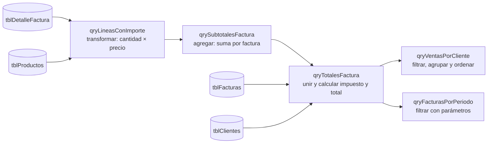

# Laboratorio 4 · Consultas: operar sobre colecciones

Hoy calculas importes, subtotales, impuestos y totales con consultas. Descubrirás que cada consulta es una operación clásica sobre colecciones: filtrar, transformar, agregar, unir u ordenar.

## Objetivos

- Relacionar las operaciones sobre colecciones con las partes de una consulta.
- Crear consultas con campos calculados, criterios, orden y parámetros.
- Calcular el total de cada factura encadenando consultas.
- Leer y escribir SQL Firebird y distinguir vistas del motor de consultas guardadas de Base.
- Guardar la configuración del sistema en una tabla de un solo registro.

## Conceptos

**Operaciones sobre colecciones.** Todo lo que harás hoy es una combinación de seis operaciones que ya conoces de programación.

| Operación | En SQL | En programación | Ejemplo en el sistema |
| --- | --- | --- | --- |
| Filtrar | `WHERE` | `filter` | Facturas emitidas o pagadas |
| Proyectar | Lista del `SELECT` | Elegir campos | Solo número y total |
| Transformar | Campo calculado | `map` | Importe = cantidad × precio |
| Agregar | `GROUP BY` con `Sum` o `Count` | `reduce` | Subtotal por factura |
| Unir | `JOIN` | Seguir referencias | Factura con su cliente |
| Ordenar | `ORDER BY` | `sort` | Clientes por monto vendido |

> **Conexión:** una consulta describe qué resultado quieres, no cómo obtenerlo. El motor Firebird decide si recorre la tabla o usa un índice. A ese estilo se le llama programación declarativa.

**Encadenar consultas.** Una vista SQL del motor puede usarse como una tabla en otra consulta. Así el total se arma como una tubería: cada paso hace una sola cosa y se prueba por separado.



**Configuración en una tabla.** `tblParametros` guarda en un solo registro los datos de la empresa que emite las facturas y la tasa de impuesto vigente. La clave principal no admite un `Id` repetido y la restricción `CHECK ("Id" = 1)` no admite otro valor, así que la tabla no puede tener un segundo registro. Los datos de la empresa se imprimen en el encabezado de cada factura (laboratorio 5).

**Tasa vigente y tasa aplicada.** La tasa aparece en dos tablas y cada una significa algo distinto:

| Campo | Qué guarda | Quién lo usa |
| --- | --- | --- |
| `tblParametros.TasaImpuesto` | La tasa vigente hoy | El formulario de facturas, que la copia en cada factura nueva (laboratorio 5) |
| `tblFacturas.TasaImpuesto` | La tasa aplicada a esa factura | `qryTotalesFactura`, que calcula con ella el impuesto |

Por eso las fórmulas de este laboratorio usan `f.TasaImpuesto`, la tasa de la factura. Si el impuesto cambia, editas un solo valor en `tblParametros`, sin tocar consultas ni código: las facturas nuevas toman la tasa nueva y las anteriores conservan la suya, como el precio unitario de cada línea.

**Tres lugares para SQL.** En Herramientas → SQL se ejecuta cada comando de creación o cambio. Una consulta guardada de Base conserva un `SELECT` y puede pedir parámetros. Una **vista Firebird** conserva un `SELECT` dentro del motor y aparece con las tablas en Base; no tiene parámetros. Usaremos vistas para los cálculos reutilizables, porque el código SDBC y el SQL nativo pueden consultarlas sin depender del analizador de Base. Conservamos el prefijo `qry` por su papel en la tubería del curso.

**Redondeo explícito.** Firebird `ROUND(x, 2)` redondea los empates alejándose de cero: 2.5 → 3 y −2.5 → −3. Para los importes no negativos del curso es la regla de mitad hacia arriba. Basic usa la función `RedondearMoneda` del kit para aplicar la misma política; no dependas de una función de otro lenguaje con un redondeo diferente. El impuesto se redondea una vez sobre el subtotal, no por línea. El 16 % es un ejemplo educativo, no una regla fiscal de un país.

## Paso a paso

### Parte A · La tabla de parámetros (10 min)

1. En Herramientas → SQL ejecuta:

```sql
CREATE TABLE "tblParametros" (
    "Id" INTEGER PRIMARY KEY CHECK ("Id" = 1),
    "NombreEmpresa" VARCHAR(100),
    "DocumentoFiscalEmpresa" VARCHAR(20),
    "TasaImpuesto" DECIMAL(9,4) NOT NULL CHECK ("TasaImpuesto" BETWEEN 0 AND 1)
);
```

2. Ejecuta por separado el alta del único registro:

```sql
INSERT INTO "tblParametros" ("Id", "NombreEmpresa", "DocumentoFiscalEmpresa", "TasaImpuesto")
VALUES (1, 'Distribuidora Aula', '0011223344', 0.16);
```

3. Actualiza Tablas y abre el registro. El documento fiscal es texto; debe conservar dos ceros iniciales. Intenta guardar otro registro con `Id` 2: debe rechazarse. La restricción limita a **como máximo** una fila; no impide borrar la única. Los formularios e informes necesitan que exista.

### Parte B · Transformar: importe por línea (15 min)

1. En Consultas → Crear consulta en vista de diseño agrega `tblDetalleFactura` y `tblProductos`. Examina su unión y selecciona los campos del ejemplo. Cambia a la vista SQL; prueba primero el `SELECT` de abajo sin el encabezado `CREATE VIEW`, con «Ejecutar orden SQL directamente» activado. Debe mostrar 16 filas.
2. Ejecuta la definición completa en Herramientas → SQL para crear la vista reutilizable:

```sql
CREATE VIEW "qryLineasConImporte" AS
SELECT d."IdFactura", d."IdProducto", p."Codigo", p."Descripcion",
       d."Cantidad", d."PrecioUnitario",
       CAST(d."Cantidad" * d."PrecioUnitario" AS DECIMAL(18,4)) AS "Importe"
FROM "tblDetalleFactura" d
JOIN "tblProductos" p ON d."IdProducto" = p."IdProducto";
```

3. Actualiza las tablas y abre `qryLineasConImporte`. Un resultado calculado no es una tabla nueva con importes guardados: al cambiar una cantidad y consultar otra vez, vuelve a calcular. Deja estas vistas como fuentes de lectura.

### Parte C · Agregar: subtotal por factura (15 min)

```sql
CREATE VIEW "qrySubtotalesFactura" AS
SELECT "IdFactura", SUM("Importe") AS "Subtotal"
FROM "qryLineasConImporte"
GROUP BY "IdFactura";
```

Ejecuta en Herramientas → SQL. Prueba su `SELECT` en una consulta de Base y observa `GROUP BY` y `SUM`. Habrá una fila por cada factura con líneas. No hace falta escribir el ciclo que acumula los importes: el motor lo resuelve.

### Parte D · Unir: total por factura (20 min)

```sql
CREATE VIEW "qryTotalesFactura" AS
SELECT f."IdFactura", f."NumeroFactura", f."Fecha", f."Estado", c."RazonSocial",
       s."Subtotal", f."TasaImpuesto",
       CAST(ROUND(s."Subtotal" * f."TasaImpuesto", 2) AS DECIMAL(18,4)) AS "Impuesto",
       CAST(s."Subtotal" + ROUND(s."Subtotal" * f."TasaImpuesto", 2)
            AS DECIMAL(18,4)) AS "Total"
FROM "tblFacturas" f
JOIN "tblClientes" c ON c."IdCliente" = f."IdCliente"
JOIN "qrySubtotalesFactura" s ON s."IdFactura" = f."IdFactura";
```

Abre la vista y compara con los puntos de control. Cada factura usa su tasa guardada. `CAST` fija el tipo decimal del resultado; aplicar un formato moneda en pantalla no reemplaza esta elección de tipo.

### Parte E · Filtrar, agrupar y ordenar: ventas por cliente (15 min)

```sql
CREATE VIEW "qryVentasPorCliente" AS
SELECT "RazonSocial", COUNT(*) AS "Facturas", SUM("Total") AS "TotalVendido"
FROM "qryTotalesFactura"
WHERE "Estado" IN ('Emitida', 'Pagada')
GROUP BY "RazonSocial";
```

Ejecuta la definición y abre Consultas → Crear consulta en vista SQL. Para ordenar el resultado escribe:

```sql
SELECT "RazonSocial", "Facturas", "TotalVendido"
FROM "qryVentasPorCliente"
ORDER BY "TotalVendido" DESC;
```

Guarda este `SELECT` como `verVentasPorCliente`. La vista expresa el cálculo; el `ORDER BY` del `SELECT` expresa el orden de presentación. Sin `ORDER BY`, ningún orden de filas está garantizado.

### Parte F · Parámetros: facturas de un periodo (15 min)

1. En la ventana principal de Base, abre **Editar → Base de datos → Configuración avanzada → Configuración especial** y activa **Reemplazar parámetros con nombre por «?»**. Esta propiedad del origen de datos permite convertir `:FechaInicial` y `:FechaFinal` en los parámetros posicionales que recibe el controlador Firebird. Guarda, cierra todas las ventanas de la base y vuelve a abrir `Facturacion.odb`, para crear conexiones con la configuración nueva.
2. Si el controlador no muestra esa casilla, carga ahora `basic/modConstantes.bas` y `basic/modEstructuras.bas` en módulos de **Standard del documento**, según `00_inicio.md`. Ejecuta el procedimiento sin argumentos **`EjecutarConfiguracionParametros`** de `modEstructuras`: llama a `ConfigurarParametrosBase` y conserva las demás propiedades del origen de datos. Guarda, cierra Base y vuelve a abrir el documento. Esta carga anticipa los módulos que usarás en las sesiones 5–6; todavía no ejecutes las rutinas de cola, pila o árbol, porque sus tablas se completan en la sesión 6.
3. Crea una **consulta guardada de Base**, no una vista. En vista SQL, desactiva «Ejecutar orden SQL directamente»: Base debe interpretar los parámetros antes de enviarlos al motor.

```sql
SELECT "NumeroFactura", "Fecha", "RazonSocial", "Total"
FROM "qryTotalesFactura"
WHERE "Fecha" BETWEEN :FechaInicial AND :FechaFinal
ORDER BY "Fecha";
```

4. Guarda como `qryFacturasPorPeriodo`. Al abrirla, Base pide `FechaInicial` y `FechaFinal`; escribe el 1 y el 10 de septiembre de 2026 con el formato de fecha que muestra tu configuración regional. Los nombres llevan `:` y no espacios. No existe una declaración `PARAMETERS` en Firebird.
5. Debe devolver las facturas 1001–1004. Si el formato resulta ambiguo, comprueba por separado el filtro con los literales SQL `DATE '2026-09-01'` y `DATE '2026-09-10'`; vuelve después a la versión con parámetros.
6. Guarda y cierra Base; copia `Facturacion.odb` como `copias/Facturacion_lab04.odb`.

## Puntos de control

`qryTotalesFactura` debe mostrar estos valores:

| Factura | Estado | Cliente | Subtotal | Impuesto | Total |
| --- | --- | --- | --- | --- | --- |
| 1001 | Pagada | Papelería El Estudiante, S.A. | 1,844.00 | 295.04 | 2,139.04 |
| 1002 | Emitida | Escuela Técnica Horizonte | 33,375.00 | 5,340.00 | 38,715.00 |
| 1003 | Emitida | Consultores Andinos, S.R.L. | 9,146.70 | 1,463.47 | 10,610.17 |
| 1004 | Pagada | Papelería El Estudiante, S.A. | 1,495.00 | 239.20 | 1,734.20 |
| 1005 | Emitida | Clínica Dental Sonrisas | 3,954.80 | 632.77 | 4,587.57 |
| 1006 | Anulada | Juan Carlos Méndez | 11,499.00 | 1,839.84 | 13,338.84 |
| Sin número | Borrador | Talleres Mecánicos Rodríguez | 14,348.00 | 2,295.68 | 16,643.68 |

- [ ] `qryTotalesFactura` coincide con la tabla anterior.
- [ ] `verVentasPorCliente` muestra 4 clientes: primero Escuela Técnica Horizonte (38,715.00) y Papelería El Estudiante con 2 facturas y 3,873.24.
- [ ] La sustitución de parámetros con nombre está activa y `qryFacturasPorPeriodo` del 1 al 10 de septiembre devuelve las facturas 1001 a 1004.
- [ ] `tblParametros` rechaza un segundo registro.

## Tarea 4 · Ventas por producto y por mes

1. Crea `qryVentasPorProducto`: unidades y monto vendido por producto, solo de facturas emitidas o pagadas, de mayor a menor monto.
2. Crea `qryVentasPorMes`: total facturado por año y mes. Pista: `EXTRACT(YEAR FROM "Fecha")` y `EXTRACT(MONTH FROM "Fecha")` en el `GROUP BY`.
3. Para cada consulta, indica qué operaciones de colecciones usa.
4. Reto: modifica una copia de `qryTotalesFactura` para que las facturas sin líneas aparezcan con total 0. Pista: `LEFT JOIN` y `COALESCE(s."Subtotal", 0)`. Crea otra vista con un nombre distinto para conservar el resultado original.

## Autoevaluación

1. ¿Qué operación de colecciones hace `GROUP BY` con `Sum`?
2. ¿Por qué conviene dividir el cálculo del total en tres consultas?
3. ¿Qué pasaría si la tasa estuviera escrita como 0.16 dentro de la consulta y el impuesto cambiara?
4. ¿Por qué una factura sin líneas no aparece en `qryTotalesFactura`?

## Referencias

[Parámetros y SQL directo en Base](https://help.libreoffice.org/latest/es/text/sdatabase/02010100.html), [sustitución de parámetros con nombre](https://help.libreoffice.org/latest/es/text/sdatabase/dabaadvpropdat.html) y [funciones, vistas y redondeo de Firebird 3](https://www.firebirdsql.org/file/documentation/html/en/refdocs/fblangref30/firebird-30-language-reference.html).
