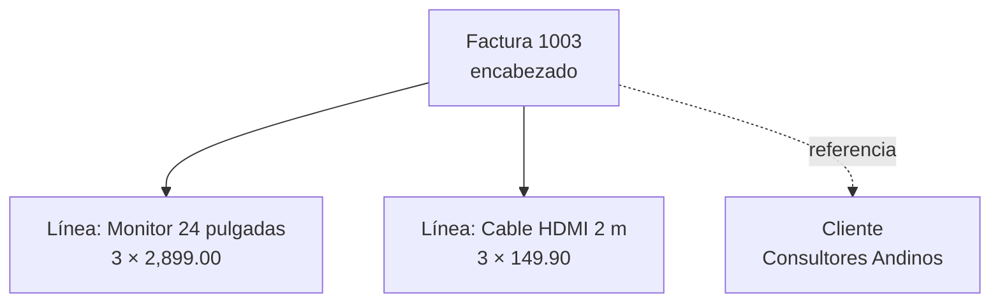

# Laboratorio 5 · Maestro-detalle e informe

Hoy construyes en Base un formulario Writer para capturar facturas con sus líneas y un informe que genera la factura imprimible. Ambos reflejan un padre con sus hijos.

## Objetivos

- Representar la jerarquía factura–líneas con un formulario y subformularios ligados por clave.
- Mostrar nombres en cuadros de lista y almacenar identificadores.
- Asociar eventos reales de controles de LibreOffice a procedimientos Basic que copian valores históricos.
- Consultar totales calculados en un subformulario de lectura.
- Diseñar un informe agrupado y generar solo la factura actual antes de imprimir.

## Conceptos

**Jerarquía padre-hijo.** La factura es un árbol de profundidad 1: la raíz es el encabezado y las hojas son las líneas. Los controles están sobre una página Writer, pero cada formulario de datos posee su propio conjunto de filas. La relación maestro–subformulario usa `IdFactura`.



**Mostrar y guardar.** Para seleccionar una referencia en Base se usa un **cuadro de lista**: la primera columna del SQL es el texto visible y la segunda el ID guardado. `Campo ligado = 1` significa segunda columna porque se cuenta desde cero. Un cuadro combinado permite introducir texto; no proporciona automáticamente esa relación nombre–ID.

**Eventos y objetos UNO.** Cada control ofrece su lista de eventos en Propiedades → Eventos. Se elige una macro, cuyo nombre no determina cuándo se ejecuta. El argumento `evento` identifica el origen; el modelo del control pertenece a un formulario de datos. `updateString` cambia su fila pendiente, `insertRow`/`updateRow` la guardan y `reload` vuelve a leerla. Esto es programación dirigida por eventos, con objetos UNO nativos.

**Fuente calculada de lectura.** Las expresiones SQL producen `Importe`, `Subtotal`, `Impuesto` y `Total`. Un campo numérico de Writer no calcula una fórmula escrita como texto: se liga al resultado de una vista. El formulario de captura usa tablas y el de totales usa una vista y prohíbe altas, cambios y borrados.

**Informe agrupado.** El diseño contiene secciones. Ejecutarlo produce un documento Writer con una instantánea: cambiar la base después no cambia ese documento ya generado.

| Sección | Qué muestra | Recorrido |
| --- | --- | --- |
| Encabezado del grupo `IdFactura` | Empresa, factura y cliente | Entrada al padre |
| Detalle | Una fila por línea | Cada hijo |
| Pie del grupo | Subtotal, impuesto y total | Salida del padre |

## Paso a paso

### Parte A · Formulario con subformulario (25 min)

1. En Base, Formularios → Usar el asistente para crear un formulario. Selecciona `tblFacturas` y añade todos sus campos.
2. Marca **Añadir subformulario**, usa la relación existente factura–detalle y selecciona los campos de `tblDetalleFactura`. Si el asistente pide unión manual, vincula `IdFactura` maestro con `IdFactura` esclavo.
3. Elige controles del encabezado en columnas y el detalle **como hoja de datos**, para ver varias líneas. Permite ver y modificar los registros existentes. Guarda el documento como `frmFacturas` y elige modificar el diseño.
4. Activa Ver → Barras de herramientas → Controles de formulario y Diseño de formulario. Abre el **Navegador de formularios**: verás un formulario principal y un subformulario, además de sus controles. Renombra el principal `fFactura` y el secundario `sfDetalle`. Son nombres de modelos dentro de un documento, no dos archivos distintos.
5. En propiedades de `fFactura`, pestaña Datos, verifica tipo de contenido **Tabla**, contenido `tblFacturas`. En `sfDetalle`, contenido `tblDetalleFactura`, **Vincular campos maestros** `IdFactura` y **Vincular campos esclavos** `IdFactura`.
6. Deja el ID automático del encabezado como solo lectura y oculta la columna `IdFactura` del detalle (la asigna el vínculo). Guarda el diseño. Desactiva Modo diseño, navega a número 1003 y verifica sus dos líneas.

> **Captura sugerida:** `frmFacturas` con el Navegador de formularios y la factura 1003. Guarda primero el encabezado nuevo: sin su clave aún no puedes guardar hijos válidos.

### Parte B · Listas y totales calculados (20 min)

1. En Modo diseño selecciona el control del cliente, fuera de su etiqueta, y usa clic derecho → Reemplazar por → Cuadro de lista. También puedes eliminar el control y dibujar uno nuevo. En Propiedades de control → Datos configura:

| Propiedad | Valor |
| --- | --- |
| Nombre (General) | `lstCliente` |
| Campo de datos | `IdCliente` |
| Tipo del contenido de lista | SQL |
| Contenido de lista | SQL siguiente |
| Campo ligado | `1` |
| Desplegable (General) | Sí |

```sql
SELECT "RazonSocial", "IdCliente"
FROM "tblClientes" ORDER BY "RazonSocial";
```

2. En el detalle, haz clic derecho **en el encabezado de la columna** `IdProducto` → Reemplazar por → Cuadro de lista. Nombre `lstProducto`, campo de datos `IdProducto`, contenido SQL siguiente y Campo ligado `1`:

```sql
SELECT "Descripcion", "IdProducto"
FROM "tblProductos" WHERE "Activo" = TRUE ORDER BY "Descripcion";
```

La segunda columna conserva el ID; no añadas una tercera columna para el precio. Lo consultarás por ID y lo copiarás a la línea para conservar el precio pactado.

3. Sustituye `Estado` por cuadro de lista con tipo **Lista de valores**: en General, entradas `Borrador`, `Emitida`, `Pagada`, `Anulada`; en Datos, contenido de lista con los mismos cuatro valores, uno por entrada, y campo de datos `Estado`. Comprueba que lo almacenado es el texto, no el índice 0–3. La restricción SQL mantiene esa defensa incluso fuera del control.
4. Crea otro subformulario de `fFactura` desde el Navegador (clic derecho → Nuevo → Formulario). Nómbralo `sfTotales`. En Datos: tipo **Tabla**, contenido `qryTotalesFactura` (es una vista del motor), campos maestro/esclavo `IdFactura`. Permitir adiciones/modificaciones/eliminaciones: **No**; solo lectura en los controles.
5. Con `sfTotales` seleccionado en el Navegador, añade tres campos formateados usando **Añadir campo**: `Subtotal`, `Impuesto`, `Total`. Nombres `txtSubtotal`, `txtImpuesto`, `txtTotal`; formato moneda, dos decimales. Confirma que cada control pertenece a `sfTotales`, no a `fFactura` ni a `sfDetalle`.
6. Para mostrar importes de todas las líneas, crea de igual forma `sfImportes`, hijo de `fFactura`, sobre la vista `qryLineasConImporte`, vínculo `IdFactura`, todas las operaciones de escritura en No. Añade un control de tabla con `Descripcion`, `Cantidad`, `PrecioUnitario`, `Importe` y formato moneda en los dos últimos. Es una presentación calculada; el detalle editable continúa ligado a `tblDetalleFactura`.

> **Dos conjuntos de datos:** guardar una fila de captura y refrescar sus resultados son acciones distintas. La sección siguiente las coordina. Una factura sin líneas no tiene fila en `qryTotalesFactura`, por el `INNER JOIN` aprendido en la sesión 4.

### Parte C · Macros y eventos nativos (30 min)

Carga `modEstructuras` para `ConexionBase()` según `00_inicio.md`; todavía no ejecutes la solución final ni el constructor del instructor. Crea en la biblioteca **Standard del documento** un módulo estándar `modInterfaz`. Este módulo se construye como ejercicio; no reemplaza las clases del kit.

Primero añade estas funciones auxiliares. Un evento de un botón suele traer un control; «Después de actualizar» puede traer su modelo. Una columna de la cuadrícula tiene como padre la cuadrícula, y luego el formulario: por eso buscamos el formulario ascendiendo.

```vb
Option Explicit

Function FormularioDelControl(evento As Object) As Object
    Dim origen As Object
    origen = evento.Source
    If HasUnoInterfaces(origen, "com.sun.star.awt.XControl") Then
        origen = origen.Model
    End If
    Do While Not HasUnoInterfaces(origen, "com.sun.star.sdbc.XRow")
        origen = origen.Parent
    Loop
    FormularioDelControl = origen
End Function

Sub GuardarFila(formulario As Object)
    If Not formulario.IsModified Then Exit Sub
    If formulario.IsNew Then
        formulario.insertRow()
    Else
        formulario.updateRow()
    End If
End Sub
```

1. Añade `CopiarPrecioSeleccionado`. En Modo diseño selecciona la columna `lstProducto` y, en Eventos, asigna esta macro a **Después de actualizar** (After updating). La selección ya llegó al búfer del formulario, pero todavía no se ha guardado toda la fila.

```vb
Sub CopiarPrecioSeleccionado(evento As Object)
    On Error GoTo Fallo
    Dim f As Object, consulta As Object, resultado As Object, id As Long
    f = FormularioDelControl(evento)
    id = f.getLong(f.findColumn("IdProducto"))
    If f.wasNull() Then Exit Sub
    consulta = ConexionBase(f.ActiveConnection).prepareStatement( _
        "SELECT ""Precio"" FROM ""tblProductos"" WHERE ""IdProducto"" = ?")
    consulta.setLong(1, id)
    resultado = consulta.executeQuery()
    If resultado.next() Then
        f.updateString(f.findColumn("PrecioUnitario"), resultado.getString(1))
    End If
    resultado.close() : consulta.close()
    Exit Sub
Fallo:
    MsgBox "No se pudo copiar el precio: " & Error$, 16, "Facturación"
End Sub
```

Se consulta mediante parámetro, no concatenando un valor del usuario. El precio decimal se lleva como texto numérico del motor al búfer decimal de la línea, conservando las cuatro cifras. No se calcula con `Double`. El procedimiento **copia**, no guarda todavía una línea posiblemente incompleta: el usuario debe introducir cantidad y luego guardar.

2. Añade la tasa vigente para una fila nueva. En el Navegador selecciona `fFactura`, Propiedades del formulario → Eventos → **Después de restablecer** (After resetting) y asigna `AplicarTasaVigente`. Al abrir un registro existente la condición impide cambiar su tasa histórica; al entrar a un registro nuevo la copia del parámetro sustituye el valor inicial de la tabla.

```vb
Sub AplicarTasaVigente(evento As Object)
    On Error GoTo Fallo
    Dim f As Object, consulta As Object, resultado As Object
    f = evento.Source
    If Not f.IsNew Then Exit Sub
    consulta = ConexionBase(f.ActiveConnection).prepareStatement( _
        "SELECT ""TasaImpuesto"" FROM ""tblParametros"" WHERE ""Id"" = 1")
    resultado = consulta.executeQuery()
    If Not resultado.next() Then
        resultado.close() : consulta.close()
        MsgBox "Falta el registro de tblParametros; no guardes la factura.", 16
        Exit Sub
    End If
    f.updateString(f.findColumn("TasaImpuesto"), resultado.getString(1))
    resultado.close() : consulta.close()
    Exit Sub
Fallo:
    MsgBox "No se pudo aplicar la tasa: " & Error$, 16, "Facturación"
End Sub
```

Comprueba el evento en tu instalación: crea un borrador, verifica 0.16, cancélalo; cambia temporalmente el parámetro a 0.15 y entra de nuevo a una fila nueva. Debe mostrar 0.15, mientras la 1003 conserva 0.16. Restaura después los parámetros. No elijas un evento que se dispare después de insertar: sería demasiado tarde para decidir el valor de la fila.

3. Añade a `fFactura` un botón llamado `cmdActualizar`, etiqueta **Guardar y actualizar**, acción normal de botón; desactiva el asistente de controles al crearlo. Asigna `ActualizarTotales` a **Ejecutar acción** (Execute action):

```vb
Sub ActualizarTotales(evento As Object)
    On Error GoTo Fallo
    Dim f As Object
    f = FormularioDelControl(evento)
    GuardarFila f
    GuardarFila f.getByName("sfDetalle")
    f.getByName("sfTotales").reload()
    f.getByName("sfImportes").reload()
    Exit Sub
Fallo:
    MsgBox "No se guardaron o actualizaron los datos: " & Error$, 16, "Facturación"
End Sub
```

Al pulsar el botón, el foco sale del control editado y su valor se incorpora al búfer. Después se guarda el encabezado, luego el detalle y finalmente se refrescan los subformularios de lectura. Si una restricción impide guardar, el error se muestra y no se promete un total nuevo. Guarda las filas antes de imprimir también.

4. Desactiva Modo diseño. Crea una línea de prueba: verifica que seleccionar producto copia el precio, que el vínculo pone `IdFactura` y que Guardar y actualizar muestra el nuevo importe y total. Borra la prueba y vuelve a pulsar el botón. Navega entre facturas: el vínculo muestra los totales del encabezado actual. Si añades automatización después, usa eventos del formulario que ocurran **tras** guardar o borrar, no una supuesta equivalencia de nombres de otro programa.

### Parte D · El informe de factura (25 min)

1. Crea esta vista mediante Herramientas → SQL:

```sql
CREATE VIEW "qryFacturaImpresion" AS
SELECT p."NombreEmpresa", p."DocumentoFiscalEmpresa",
       t."IdFactura", t."NumeroFactura", t."Fecha", t."Estado", t."RazonSocial",
       c."DocumentoFiscal", c."Direccion", c."Ciudad",
       l."Codigo", l."Descripcion", l."Cantidad", l."PrecioUnitario", l."Importe",
       t."Subtotal", t."TasaImpuesto", t."Impuesto", t."Total"
FROM "qryTotalesFactura" t
JOIN "tblFacturas" f ON f."IdFactura" = t."IdFactura"
JOIN "tblClientes" c ON c."IdCliente" = f."IdCliente"
JOIN "qryLineasConImporte" l ON l."IdFactura" = t."IdFactura"
CROSS JOIN "tblParametros" p;
```

`CROSS JOIN` combina cada línea con la única fila de parámetros. Cero filas de parámetros dan informe vacío; dos filas duplicarían las líneas, pero la clave y el `CHECK` impiden ese segundo registro. La tasa calculada sigue siendo la de la factura.

2. Actualiza Tablas. En Informes → Usar el asistente para crear un informe, elige la vista `qryFacturaImpresion`, añade los campos y agrupa por `IdFactura`; ordena detalle por `Descripcion`. Nombra el informe `rptFactura`, tipo dinámico (datos actuales al ejecutarlo), y elige modificar su diseño. Si el asistente no está disponible, comprueba el JRE y usa **Crear informe en vista de diseño**, Datos → Tipo de contenido Tabla → Contenido `qryFacturaImpresion`.
3. En el Diseñador de informes, abre Ver → Ordenar y agrupar. Define grupo por `IdFactura` y activa **Encabezado de grupo** y **Pie de grupo**. El grupo es la factura, no cada producto.
4. Mueve los campos de empresa, número, fecha y cliente al encabezado de grupo. Conserva en Detalle solamente `Codigo`, `Descripcion`, `Cantidad`, `PrecioUnitario` e `Importe`. Mueve `Subtotal`, `Impuesto`, `Total` al pie de grupo, con formato moneda y dos decimales.
5. Los tres totales ya llegan calculados en cada línea. En el pie muéstralos **una vez** como campos directos; no uses `SUM(Total)`, que los multiplicaría por la cantidad de líneas. Para el estado de cuenta de la tarea sí se suma un total por factura.
6. Selecciona el encabezado del grupo y ajusta su propiedad **Forzar nueva página: Antes** para empezar cada factura en una página. Revisa los encabezados repetidos de página, anchos de columnas y tamaño del papel; la factura 1003 debe caber en una página.
7. Guarda y ejecuta el informe. Se abre un Writer generado: entra a Archivo → Vista previa de impresión. Verifica cada factura y su empresa. Cierra el resultado; vuelve al diseño solo cuando necesites editarlo.

> **Captura sugerida:** la página de factura 1003 con dos líneas y total 10,610.17. Un informe bien filtrado no contiene páginas de otras facturas.

### Parte E · Generar la factura actual (10 min)

1. Prueba primero el filtro manual: en propiedades **del informe completo** (selección «Informe»), Datos → Filtro, escribe `"IdFactura" = 3` sin `WHERE`. Ejecuta y verifica que el documento contiene solamente la factura 1003. Borra el filtro, guarda el diseño y ciérralo. El filtro usa ID interno 3; no confundas ID con número 1003.
2. Añade a `fFactura` un botón `cmdImprimir`, etiqueta **Vista de factura**, acción normal. Asigna el siguiente procedimiento a Ejecutar acción. Usa la definición del informe y el motor UNO, genera una copia filtrada y abre el resultado Writer; el usuario revisa antes de imprimir o exportar PDF.

```vb
Sub ImprimirFacturaActual(evento As Object)
    On Error GoTo Fallo
    Dim f As Object, definicion As Object, subdocumento As Object
    Dim motor As Object, salida As Object, url As Variant
    Dim id As Long, filtroAnterior As String, modificado As Boolean
    ActualizarTotales evento
    f = FormularioDelControl(evento)
    If f.IsNew Or f.IsModified Or f.getByName("sfDetalle").IsModified Then
        MsgBox "Guarda una factura válida antes de generar el informe.", 48
        Exit Sub
    End If
    id = f.getLong(f.findColumn("IdFactura"))
    If f.wasNull() Then Exit Sub
    subdocumento = ThisDatabaseDocument.ReportDocuments.getByName("rptFactura")
    definicion = subdocumento.openDesign()
    filtroAnterior = definicion.Filter
    modificado = definicion.isModified()
    definicion.Filter = """IdFactura"" = " & CStr(id)
    motor = CreateUnoService("com.sun.star.report.ReportEngine")
    motor.ActiveConnection = ConexionBase(f.ActiveConnection)
    motor.ReportDefinition = definicion
    url = motor.createDocument()
    definicion.Filter = filtroAnterior
    definicion.setModified(modificado)
    subdocumento.close()
    motor.dispose()
    salida = StarDesktop.loadComponentFromURL(url.Complete, "_blank", 0, Array())
    Exit Sub
Fallo:
    On Error Resume Next
    definicion.Filter = filtroAnterior
    definicion.setModified(modificado)
    subdocumento.close()
    motor.dispose()
    MsgBox "No se pudo generar la factura: revisa el informe, Java y los datos.", 16
End Sub
```

3. Mantén cerrado y guardado el diseñador antes de probar el botón. Navega a 1003, guarda y actualiza, pulsa Vista de factura; revisa página y total. Repite en 1001 para demostrar que el filtro cambia con la factura seleccionada. La macro restaura el filtro del diseño; no guarda una selección temporal como filtro permanente.
4. Para imprimir usa Archivo → Imprimir en el Writer generado. Para entregar electrónicamente, exporta PDF y abre el archivo para comprobarlo. No confundas el diseño dinámico con el documento ya generado: si cambian datos, genera otro resultado.

### Parte F · Observa lo que todavía permite el sistema (10 min)

1. En 1001, que está Pagada, cambia cantidad de la primera línea de 10 a 11 y guarda. El formulario ligado directamente a las tablas lo permite: las restricciones estructurales siguen cumplidas.
2. Crea una factura nueva con estado Emitida, sin líneas y sin número. Firebird también la acepta con el esquema actual.
3. Escribe las dos reglas que faltan y la diferencia entre integridad referencial y reglas de ciclo de vida. Las sesiones 7–8 construirán objetos que controlen esas operaciones.
4. Restaura cantidad 10 y borra la factura de prueba. Confirma los totales originales, guarda y cierra Base; copia `Facturacion.odb` como `copias/Facturacion_lab05.odb`.

## Puntos de control

- [ ] `frmFacturas` muestra 1003 con 2 líneas y totales 9,146.70, 1,463.47 y 10,610.17.
- [ ] La lista del cliente muestra razón social y guarda `IdCliente`; producto hace lo mismo.
- [ ] Elegir un producto copia su precio a la fila pendiente, antes de guardarla.
- [ ] Entrar a un borrador nuevo toma la tasa vigente; navegar a una factura existente conserva su tasa.
- [ ] Guardar y actualizar persiste antes de refrescar resultados de lectura.
- [ ] `rptFactura` comienza cada factura en una página y Vista de factura genera solo la actual.
- [ ] El informe muestra nombre y documento fiscal de la empresa.
- [ ] Se documentaron y revirtieron las dos pruebas de reglas de negocio todavía no protegidas.

## Tarea 5 · Estado de cuenta por cliente

1. Crea `rptEstadoCuenta`: fuente `qryTotalesFactura`, filtro Estado Emitida o Pagada, grupo por cliente, detalle con fecha, número, estado y total; suma de `Total` en el pie del cliente. Esta fuente trae una fila por factura, por lo que la suma no duplica sus líneas.
2. Dibuja en Mermaid el árbol de secciones del informe.
3. Describe dos reglas que el formulario todavía deja romper y propón dónde debería vivir cada una.

## Autoevaluación

1. ¿Qué campo vincula maestro y subformulario y por qué?
2. ¿Qué muestra y qué guarda la lista cuya consulta devuelve razón social e ID y cuyo Campo ligado es 1?
3. ¿Por qué se copia el precio en la línea en vez de consultarse siempre desde productos?
4. ¿En qué orden recorre un informe las secciones de una factura?

## Referencias

[Datos de controles y columna ligada](https://help.libreoffice.org/latest/es/text/shared/02/01170102.html), [propiedades de subformularios](https://help.libreoffice.org/latest/es/text/shared/02/01170203.html), [eventos de controles](https://help.libreoffice.org/latest/es/text/shared/02/01170103.html), [Diseñador de informes](https://help.libreoffice.org/latest/es/text/sdatabase/rep_main.html), [filtro del ReportDefinition](https://api.libreoffice.org/docs/idl/ref/interfacecom_1_1sun_1_1star_1_1report_1_1XReportDefinition.html), [motor de informes UNO](https://api.libreoffice.org/docs/idl/ref/interfacecom_1_1sun_1_1star_1_1report_1_1XReportEngine.html) y [apertura de subdocumentos](https://api.libreoffice.org/docs/idl/ref/interfacecom_1_1sun_1_1star_1_1sdb_1_1XSubDocument.html).
