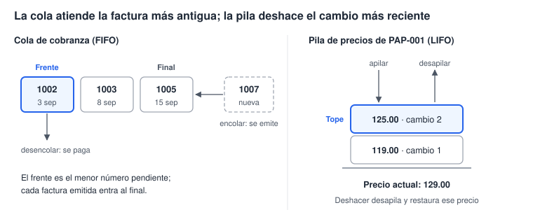
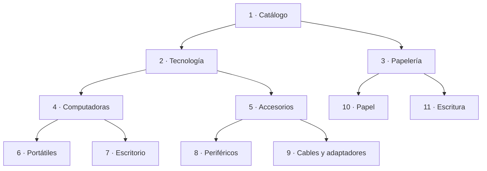

# Laboratorio 6 · Cola, pila, árbol y diccionario

Hoy reconoces cuatro estructuras clásicas dentro del sistema de facturación y las implementas con tablas, consultas y LibreOffice Basic.

## Objetivos

- Definir un tipo abstracto de datos (TAD) como datos más sus operaciones permitidas.
- Implementar una cola de cobranza (FIFO) y atender su frente.
- Implementar una pila de cambios de precio (LIFO) que permite deshacer.
- Modelar las categorías como un árbol con una relación reflexiva y recorrerlo con recursión.
- Usar un diccionario en memoria para acumular valores por clave.

## Conceptos

**Tipo abstracto de datos.** Un TAD define qué operaciones se permiten sobre los datos, no cómo se guardan. Una cola y una pila pueden guardar los mismos registros: lo que cambia es la regla de acceso.

| Estructura | Disciplina de acceso | Operaciones | En el sistema |
| --- | --- | --- | --- |
| Cola | FIFO: el primero en entrar es el primero en salir | Encolar, desencolar, ver el frente | Facturas emitidas pendientes de cobro |
| Pila | LIFO: el último en entrar es el primero en salir | Apilar, desapilar, ver el tope | Cambios de precio que se pueden deshacer |
| Árbol | Jerarquía: cada nodo tiene un padre, salvo la raíz | Hijos, padre, recorrer | Categorías de productos |
| Diccionario | Acceso directo por clave | Agregar, existe, obtener | Unidades vendidas por producto |



**Cola de cobranza.** Una factura entra a la cola cuando se emite y sale cuando se paga. El número de factura se asigna en orden de emisión, así que funciona como el turno en una fila: el frente es el menor número pendiente.

**Pila de precios.** Antes de cambiar un precio, el sistema apila el precio anterior en `tblHistorialPrecios`. Deshacer desapila el cambio más reciente y restaura ese precio. El autonumérico `IdCambio` marca el orden de llegada, así que el tope es el mayor `IdCambio`.

> **Ojo:** Firebird usa `FIRST 1`. Ordena por un campo único, como `IdCambio` o `NumeroFactura`, para que el frente o el tope sea determinista.

**Árbol de categorías.** Cada categoría guarda el Id de su padre en `IdCategoriaPadre`, y la raíz lo deja vacío. Es una relación reflexiva: la tabla se relaciona consigo misma.



Firebird admite consultas recursivas (`WITH RECURSIVE`). Aquí recorremos el árbol con Basic para observar la pila de llamadas: visita el nodo y después a cada hijo (preorden). La alternativa SQL se puede comparar como ampliación; está descrita en la [referencia oficial de Firebird](https://www.firebirdsql.org/file/documentation/html/en/refdocs/fblangref30/firebird-30-language-reference.html).

> **Conexión:** el recorrido en preorden es el que usa el Explorador de archivos para mostrar carpetas y subcarpetas.

**Diccionario.** Un diccionario guarda pares clave → valor y ofrece operaciones para consultar directamente una clave. Una implementación con tabla hash suele encontrarla en tiempo casi constante; la complejidad concreta depende de la implementación. LibreOffice ofrece el servicio `ScriptForge.Dictionary`, disponible en Windows, Linux y macOS. Su biblioteca se carga con `GlobalScope.BasicLibraries.LoadLibrary("ScriptForge")`. Consulta la [referencia oficial](https://help.libreoffice.org/latest/es/text/sbasic/shared/03/sf_dictionary.html).

## Paso a paso

### Parte A · Prepara el código (5 min)

Crea primero `modConstantes` con `basic/modConstantes.bas` (helpers de dinero y errores), luego el módulo `modEstructuras` en Standard de tu `.odb` y pega `basic/modEstructuras.bas` completo (ver «Cómo cargar y ejecutar los módulos Basic» en [00_inicio.md](00_inicio.md)). Guarda y ejecuta sus rutinas desde el documento Base abierto. Agrega otro módulo `modLaboratorio6` para las pequeñas pruebas con argumentos que aparecen abajo.

### Parte B · La cola de cobranza (20 min)

1. Crea la consulta `qryColaCobranza`:

```sql
SELECT "NumeroFactura", "Fecha", "RazonSocial", "Total"
FROM "qryTotalesFactura"
WHERE "Estado" = 'Emitida'
ORDER BY "NumeroFactura";
```

Guarda con el nombre `qryColaCobranza`. `qryTotalesFactura` es la vista del motor construida en el laboratorio 4: puedes activar «Ejecutar orden SQL directamente». Las rutinas SDBC del kit consultan las tablas con su propio SQL.

2. Ábrela: tiene las facturas 1002, 1003 y 1005, con 1002 al frente.
3. En `modLaboratorio6` agrega y ejecuta esta `Sub` sin argumentos:

```vb
Sub CobrarUnaFactura()
    MsgBox "Factura atendida: " & AtenderSiguienteCobro()
End Sub
```

4. Debe mostrar 1002. Cierra y vuelve a abrir `qryColaCobranza`: ahora el frente es 1003. `VerColaCobranza` también muestra la cola sin guardar una consulta adicional.
5. Lee `AtenderSiguienteCobro` en el módulo. Su búsqueda usa:

```sql
SELECT FIRST 1 "IdFactura", "NumeroFactura"
FROM "tblFacturas"
WHERE "Estado" = 'Emitida'
ORDER BY "NumeroFactura";
```

La conexión SDBC se obtiene con `ConexionBase()`. Un resultado avanza mediante `rs.next()`; si no hay fila, la función devuelve 0. Al atender, el módulo cambia el estado con una sentencia preparada y confirma la transacción. Si falla, revierte el cambio y conserva el orden de la cola.

### Parte C · La pila de cambios de precio (25 min)

1. En Herramientas → SQL ejecuta la siguiente definición. Cierra el diálogo y actualiza la lista de tablas; la clave foránea impone la relación con `tblProductos`:

```sql
CREATE TABLE "tblHistorialPrecios" (
    "IdCambio" INTEGER GENERATED BY DEFAULT AS IDENTITY PRIMARY KEY,
    "IdProducto" INTEGER NOT NULL,
    "PrecioAnterior" DECIMAL(18,4) NOT NULL CHECK ("PrecioAnterior" >= 0),
    "FechaCambio" TIMESTAMP DEFAULT CURRENT_TIMESTAMP NOT NULL,
    CONSTRAINT "fkHistorialProducto" FOREIGN KEY ("IdProducto")
        REFERENCES "tblProductos" ("IdProducto")
);
```

2. Agrega y ejecuta en tu módulo de pruebas:

```vb
Sub CambiarDosPrecios()
    CambiarPrecio 11, 125
    CambiarPrecio 11, 129
    MsgBox "Comprueba PAP-001: 129.00 y dos entradas en el historial."
End Sub

Sub DeshacerUnPrecio()
    MsgBox "Se deshizo un cambio: " & DeshacerUltimoCambio(11)
End Sub
```

Ejecuta `CambiarDosPrecios` una vez y abre las tablas: precio 129.00, historial con dos filas. Ejecuta `DeshacerUnPrecio` y vuelve a abrir: precio 125.00, una fila. Ejecútalo otra vez: precio 119.00, historial vacío. Los dos primeros deshacer devuelven verdadero (`True`); la tercera ejecución devuelve falso (`False`) y conserva 119.00.

3. Abre `qryLineasConImporte`: las facturas 1001, 1004 y 1005 conservan 119.00 para PAP-001. El precio pactado vive en cada línea, no se recalcula desde el catálogo.
4. Busca en `DeshacerUltimoCambio` la consulta del tope:

```sql
SELECT FIRST 1 "IdCambio", "PrecioAnterior"
FROM "tblHistorialPrecios"
WHERE "IdProducto" = ?
ORDER BY "IdCambio" DESC;
```

El `?` se enlaza con `setInt(1, idProducto)` en una sentencia preparada. Restaurar el precio y borrar la entrada se hacen dentro de una transacción: ambas operaciones tienen que completarse para que un deshacer sea válido.

> **Concepto:** `prepareStatement` separa el SQL de sus valores. `setInt`, `setString` y los demás métodos enlazan datos sin concatenarlos; así el separador decimal regional no cambia la consulta. El kit conserva cuatro decimales monetarios con `DECIMAL(18,4)` y `Currency`.

### Parte D · El árbol de categorías (30 min)

1. En Herramientas → SQL agrega el padre nullable:

```sql
ALTER TABLE "tblCategorias" ADD "IdCategoriaPadre" INTEGER;
```

Actualiza las tablas. La raíz usa SQL NULL, no 0 ni una cadena vacía.
2. Abre la tabla y llena `IdCategoriaPadre` según el diagrama: 1 queda vacío; 2 y 3 tienen padre 1; 4 y 5, padre 2; 6 y 7, padre 4; 8 y 9, padre 5; 10 y 11, padre 3.
3. En Herramientas → SQL agrega la relación reflexiva:

```sql
ALTER TABLE "tblCategorias" ADD CONSTRAINT "fkCategoriaPadre"
FOREIGN KEY ("IdCategoriaPadre") REFERENCES "tblCategorias" ("IdCategoria");
```

Actualiza las tablas y abre Herramientas → Relaciones para comprobarla. La clave foránea evita padres inexistentes, pero no evita ciclos como 2 → 4 → 2. Antes de recorrer, comprueba que cada camino llega a Catálogo; no introduzcas ciclos.
4. Agrega y ejecuta esta `Sub` en `modLaboratorio6`:

```vb
Sub MostrarArbolCategorias()
    ImprimirArbol
End Sub
```

Muestra un cuadro con:

```text
- Catálogo
    - Papelería
        - Escritura
        - Papel
    - Tecnología
        - Accesorios
            - Cables y adaptadores
            - Periféricos
        - Computadoras
            - Escritorio
            - Portátiles
```

El procedimiento reúne un texto y lo muestra al final. Cada llamada consulta los hijos del padre actual, agrega sangría según `nivel` y se llama de nuevo con el Id del hijo. Sigue la ejecución con puntos de interrupción: mientras baja por una rama, quedan llamadas pendientes de continuar con sus hermanos.

5. Crea `qryCategoriasHoja`, las categorías sin hijos. Debe devolver 6.

```sql
SELECT c."IdCategoria", c."Nombre"
FROM "tblCategorias" AS c
LEFT JOIN "tblCategorias" AS h ON c."IdCategoria" = h."IdCategoriaPadre"
WHERE h."IdCategoria" IS NULL;
```

6. Crea `qryProductosConPadre`, que sube un nivel con otra unión reflexiva:

```sql
SELECT p."Codigo", p."Descripcion",
       COALESCE(m."Nombre" || ' > ', '') || c."Nombre" AS "Ruta"
FROM "tblProductos" AS p
INNER JOIN "tblCategorias" AS c ON p."IdCategoria" = c."IdCategoria"
LEFT JOIN "tblCategorias" AS m ON c."IdCategoriaPadre" = m."IdCategoria";
```

Cada unión reflexiva sube un nivel. Como las ramas tienen profundidades distintas, ninguna cantidad fija de uniones sirve para todas: por eso existe la recursión.

### Parte E · El diccionario (15 min)

1. Agrega y ejecuta esta `Sub` en tu módulo de pruebas. Muestra cada código con las unidades vendidas:

```vb
Sub MostrarUnidadesVendidas()
    UnidadesPorProducto
End Sub
```
2. Compara con esta consulta. El resultado es el mismo, aunque el orden puede cambiar:

```sql
SELECT p."Codigo", SUM(d."Cantidad") AS "Unidades"
FROM "tblDetalleFactura" AS d
INNER JOIN "tblProductos" AS p ON d."IdProducto" = p."IdProducto"
GROUP BY p."Codigo";
```

3. Lee el corazón del procedimiento:

```vb
clave = rs.getString(1)       ' la clave es texto del código de producto
cantidad = rs.getInt(2)
If dic.Exists(clave) Then
    dic.ReplaceItem clave, dic.Item(clave) + cantidad
Else
    dic.Add clave, cantidad
End If
```

`rs` es un resultado SDBC; las posiciones de columnas empiezan en 1. El diccionario se crea con `CreateScriptService("Dictionary")` después de cargar ScriptForge. `Item` lee un valor; `ReplaceItem` lo modifica. No asignes `dic(clave)` como si fuera otro tipo de diccionario.

4. Guarda, cierra el `.odb` y haz la copia de seguridad de la sesión 6.

## Puntos de control

- [ ] Después de atender un cobro, la cola muestra 1003 y 1005.
- [ ] Tras dos cambios y dos deshacer, PAP-001 vuelve a 119.00 y la pila queda vacía.
- [ ] Las facturas 1001, 1004 y 1005 conservan 119.00 para PAP-001.
- [ ] `ImprimirArbol` muestra 11 categorías con sangría por nivel y `qryCategoriasHoja` devuelve 6.
- [ ] `UnidadesPorProducto` muestra 14 códigos y PAP-001 suma 19.

## Tarea 6 · Profundidad y ruta en el árbol

1. Escribe `Profundidad(idCategoria) As Integer`, que sube por los padres hasta la raíz. Catálogo tiene profundidad 0 y Portátiles, 3.
2. Escribe `RutaCategoria(idCategoria) As String`, que devuelve la ruta completa desde la raíz, por ejemplo `Catálogo > Tecnología > Accesorios > Periféricos`. Usa una `Collection` como pila: apila los nombres mientras subes y desapila para armar el texto.
3. Explica por qué la cola usa `NumeroFactura` y no `Fecha` para decidir el frente.
4. Propón otro lugar del sistema donde convenga una cola, una pila o un diccionario, y justifícalo.

Pista: en una `Collection`, `pila.Add x` apila, `pila(pila.Count)` lee el tope y `pila.Remove pila.Count` desapila.

## Autoevaluación

1. ¿Qué diferencia a una cola de una pila si guardan los mismos datos?
2. ¿Por qué la pila se ordena por `IdCambio` y no solo por `FechaCambio`?
3. ¿Qué es una relación reflexiva y qué estructura produce?
4. ¿Por qué un diccionario encuentra una clave sin recorrer todos los elementos?
