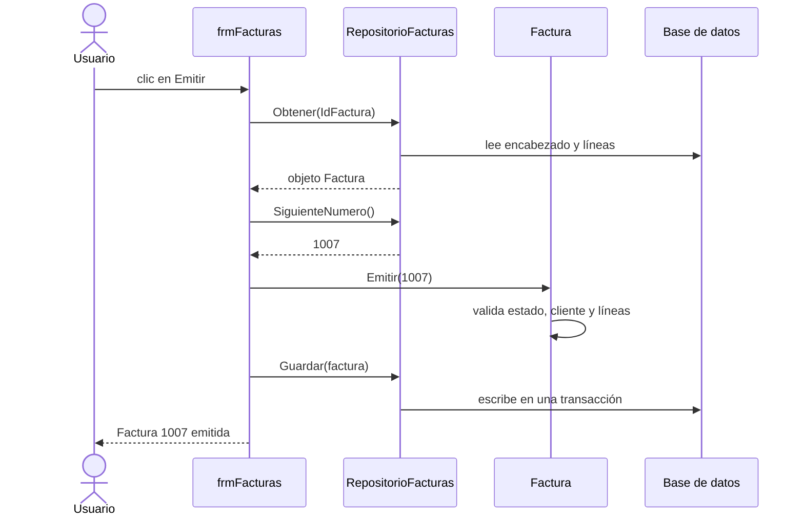

# Laboratorio 8 · Objetos en acción: clases en LibreOffice Basic

Hoy conviertes el diseño de la sesión 7 en clases de LibreOffice Basic. Al terminar, la factura protege sus propias reglas y el formulario solo le pide que se emita.

## Objetivos

- Crear módulos de clase con estado privado, propiedades y métodos.
- Implementar la composición: una factura que contiene una colección de líneas.
- Hacer cumplir el ciclo de vida de la factura dentro del objeto, con errores cuando una operación no está permitida.
- Separar la lógica del negocio de la persistencia con una clase repositorio.
- Conectar el formulario con los objetos.

## Conceptos

**Clases en Basic.** Un módulo con `Option VBASupport 1` y `Option ClassModule` al principio define una clase. Sus variables privadas son el estado, sus propiedades exponen datos y sus procedimientos públicos son los métodos.

| Concepto | En Basic | Ejemplo de uso |
| --- | --- | --- |
| Estado privado | `Private mEstado As String` | Nadie fuera de la clase lo cambia |
| Propiedad de lectura | `Public Property Get Total() As Currency` | `f.Total` |
| Propiedad de escritura con validación | `Public Property Let IdCliente(ByVal valor As Long)` | `f.IdCliente = 2` |
| Método | `Public Sub Emitir(ByVal numero As Long)` | `f.Emitir 1007` |
| Crear un objeto | `Set f = New clsFactura` | Ejecuta `Class_Initialize` |
| Error de negocio | `Err.Raise 2005, "Curso", MensajeError(2005)` | Rechaza la emisión sin líneas; el manejador consulta `Err.Number` y `Err.Description` |

**Sin constructores con parámetros.** Basic no permite pasar datos al crear un objeto. Por eso `clsLineaFactura` tiene un método `Inicializar` que valida los datos de la línea.

**Composición con una colección.** `clsFactura` guarda sus líneas en una `Collection` privada. La API de negocio agrega líneas mediante `AgregarLinea`, que primero revisa el estado. Los métodos públicos `Cargar` y `AsignarId` se reservan al repositorio: Basic no tiene la visibilidad `Friend`. `Cargar` valida el encabezado y solo reconstruye una instancia nueva; `AsignarId` no permite cambiar una identidad ya asignada. Un uso inválido produce 3010. El formulario utiliza los métodos de negocio, no estos inicializadores técnicos.

**Repositorio.** La factura no sabe SQL. `clsRepositorioFacturas` traduce entre objetos y tablas: `Obtener` arma el objeto desde la base y `Guardar` lo escribe en una transacción. Es la alta cohesión de la sesión 7.

> **Conexión:** esa traducción se llama mapeo objeto-relacional (ORM). Herramientas como Entity Framework o Hibernate la automatizan; aquí la escribes a mano para entenderla.

Así colaboran los objetos cuando pulsas Emitir:



## Paso a paso

### Parte A · Carga los módulos (10 min)

1. En Standard del documento, crea y pega los módulos en este orden: `modConstantes.bas`, `clsLineaFactura.bas`, `clsFactura_plantilla.bas`, `clsRepositorioFacturas.bas` y `modPruebasObjetos.bas`. Conserva `modEstructuras` de la sesión 6: contiene `ConexionBase()`.
2. Para `clsFactura_plantilla.bas`, nombra el módulo **`clsFactura`**. La plantilla y la solución del instructor son alternativas para ese mismo módulo; nunca las cargues juntas con nombres distintos.
3. Conserva las tres líneas iniciales de las clases:

```vb
Option VBASupport 1
Option ClassModule
Option Explicit
```

4. Guarda y ejecuta `EjecutarPruebas`, que llama a `ProbarReglas`. Basic compila al ejecutar. La plantilla compila, pero las reglas que dependen de sus tres TODO fallan. Guarda el resumen para compararlo después de completarlos.

Consulta [00_inicio.md](00_inicio.md) para crear módulos y ejecutar rutinas. Estas son clases Basic propias, con `New`, propiedades y `Collection`, según la [ayuda oficial](https://help.libreoffice.org/latest/es/text/sbasic/shared/classmodule.html).

### Parte B · Lee la clase LineaFactura (15 min)

```vb
' clsLineaFactura: un producto, su cantidad y el precio pactado
Private mIdProducto As Long
Private mDescripcion As String
Private mCantidad As Long
Private mPrecioUnitario As Currency
Private mInicializada As Boolean

Public Sub Inicializar(ByVal idProducto As Long, ByVal descripcion As String, _
                       ByVal cantidad As Long, ByVal precioUnitario As Currency)
    If mInicializada Then Err.Raise 2103, "Curso", MensajeError(2103)
    If idProducto <= 0 Then Err.Raise 2100, "Curso", MensajeError(2100)
    If cantidad <= 0 Then Err.Raise 2101, "Curso", MensajeError(2101)
    If precioUnitario < 0 Then Err.Raise 2102, "Curso", MensajeError(2102)
    mIdProducto = idProducto
    mDescripcion = descripcion
    mCantidad = cantidad
    mPrecioUnitario = precioUnitario
    mInicializada = True
End Sub

Public Property Get Cantidad() As Long
    Cantidad = mCantidad
End Property

' Experto en información: la línea calcula su propio importe
Public Property Get Importe() As Currency
    Importe = mCantidad * mPrecioUnitario
End Property
```

Las propiedades `IdProducto`, `Descripcion` y `PrecioUnitario` siguen el mismo patrón que `Cantidad`. Responde: ¿por qué no hay un `Property Let` para la cantidad?

### Parte C · Completa la clase Factura (35 min)

Lee primero lo que ya está hecho. `AgregarLinea` muestra el patrón: revisa la regla y después cambia el estado.

```vb
Public Sub AgregarLinea(ByVal idProducto As Long, ByVal descripcion As String, _
                        ByVal cantidad As Long, ByVal precioUnitario As Currency)
    Dim nueva As Object
    ExigirBorrador
    If ExisteLinea(idProducto) Then Err.Raise 2003, "Curso", MensajeError(2003)
    Set nueva = New clsLineaFactura
    nueva.Inicializar idProducto, descripcion, cantidad, precioUnitario
    mLineas.Add nueva, CStr(idProducto)
End Sub

Private Sub ExigirBorrador()
    If mEstado <> ESTADO_BORRADOR Then Err.Raise 2009, "Curso", MensajeError(2009)
End Sub
```

Completa las tres partes marcadas con TODO:

```vb
Public Property Get Subtotal() As Currency
    ' TODO 1: recorre mLineas con For Each y suma el Importe de cada línea.
End Property

Public Sub Emitir(ByVal numeroAsignado As Long)
    ExigirBorrador
    ' TODO 2: si no hay cliente (mIdCliente = 0) lanza el error 2004;
    '         si no hay líneas (mLineas.Count = 0) lanza el error 2005.
    If numeroAsignado <= 0 Then Err.Raise 2010, "Curso", MensajeError(2010)
    mNumero = numeroAsignado
    mFecha = Date
    mEstado = ESTADO_EMITIDA
End Sub

Public Sub Anular()
    ' TODO 3: si la factura no está emitida lanza el error 2007;
    '         si lo está, cambia mEstado a ESTADO_ANULADA.
End Sub
```

> **Ojo:** el curso activa `Option VBASupport 1` en todos sus módulos para usar el objeto `Err` de LibreOffice Basic. `Err.Raise numero, "Curso", MensajeError(numero)` conserva el código y el mensaje de una regla; un manejador los consulta con `Err.Number` y `Err.Description`. En este curso, la instrucción `Error n` se reserva a errores predefinidos; las reglas usan `Err.Raise` para conservar código y descripción. Consulta la [referencia oficial de Err](https://help.libreoffice.org/latest/es/text/sbasic/shared/ErrVBA.html). El modo de compatibilidad no agrega DAO ni `Implements`: la persistencia continúa usando SDBC y los contratos comunes se prueban en ejecución.

### Parte D · Prueba en memoria (15 min)

1. Ejecuta `EjecutarFactura` desde el selector de macros (llama a `ProbarFactura`). Arma en memoria una factura igual a la 1003, la emite e intenta agregarle una línea. El resumen muestra:

```text
Subtotal: 9146.70
Impuesto: 1463.47
Total: 10610.17
Rechazo esperado: error 2009 (la factura ya no es borrador).
```

La presentación puede usar coma decimal según tu sistema; compara los valores, no la puntuación.

2. Ejecuta `EjecutarPruebas` (llama a `ProbarReglas`). Prueba las reglas del ciclo de vida y muestra Correcto o FALLA para cada una.
3. Corrige los tres TODO hasta que todas las reglas digan Correcto. Comprueba también que después de un rechazo el estado y las líneas no cambiaron.
4. Sigue en el código la propiedad `Impuesto`. El curso redondea el impuesto a dos decimales con mitades hacia arriba para importes no negativos. La consulta Firebird usa `ROUND(..., 2)` y `CalcularPorcentajeMoneda` del kit reproduce la misma regla con valores de cuatro decimales. La tasa se copia a la factura; el impuesto histórico no depende de cambiar luego `tblParametros`.

> **Concepto:** `ProbarReglas` es una prueba automatizada. Ejecútala cuando cambies la clase. Sus cuadros de resultados permiten probar sin SQL ni formularios: la factura y sus líneas viven solo en memoria.

### Parte E · Del objeto a la base y de vuelta (10 min)

1. Con el documento Base abierto, ejecuta `EjecutarRepositorio` (llama a `ProbarRepositorio`). Carga la factura con `IdFactura` 3 y muestra sus líneas y totales.
2. Comprueba que el total es 10610.17, igual al de `qryTotalesFactura`. La consulta de la sesión 4 y el objeto de hoy calculan el mismo resultado.
3. Lee además las pruebas de escritura: la rutina crea un borrador temporal, lo guarda y recarga, cambia sus líneas, prueba una clave foránea inválida y un número duplicado, verifica el rollback y elimina el registro temporal. La secuencia de Id puede avanzar aunque se borre la prueba; no exijas números de Id consecutivos.
4. Lee esta colaboración en el módulo de pruebas:

```vb
Dim repo As Object, f As Object
Set repo = New clsRepositorioFacturas
repo.Inicializar ConexionBase()
Set f = repo.Obtener(3)
MsgBox "Factura " & f.Numero & ": " & Format(f.Total, "0.00")
```

`Inicializar` recibe una conexión SDBC, no un archivo o una tabla. `Obtener` reconstruye las líneas y restaura el encabezado. `Guardar` desactiva auto commit, escribe encabezado y detalle con parámetros, confirma con `commit` y revierte con `rollback` si falla. El objeto mantiene sus reglas; el repositorio coordina la persistencia.

### Parte F · Conecta el formulario (20 min)

1. Abre `frmFacturas` en modo edición. En el Navegador de formularios confirma el principal `fFactura` y el detalle `sfDetalle`, y que el principal tenga la columna `IdFactura`.
2. En el formulario principal agrega un botón, nombre `cmdEmitir`, etiqueta Emitir, acción Ninguna. En Propiedades del control → Eventos → Ejecutar acción asigna `Standard.modPruebasObjetos.EmitirDesdeFormulario` de tu documento.
3. Lee ese manejador en `modPruebasObjetos`: obtiene el formulario desde `oEvento.Source.Model.Parent`, guarda las filas pendientes del principal y de `sfDetalle`, inicializa el repositorio con la conexión aislada de `ConexionBase()`, obtiene el objeto por `IdFactura`, llama `Emitir` y `Guardar`, recarga el formulario y aplica de inmediato el bloqueo. Las excepciones se muestran en un cuadro con su código de regla.
4. En el Navegador selecciona el formulario principal `fFactura`. En sus propiedades → Eventos asigna `Standard.modPruebasObjetos.AplicarBloqueoFactura` al evento Después del cambio de registro (After record change). Si tu versión lo denomina Al cambiar el registro, elige el evento que ocurre después de posicionarse sobre la fila. No lo asignes al evento previo ni al del botón.
5. Lee el helper: consulta `Estado`, cambia `AllowUpdates` y `AllowDeletes` del principal y cambia `AllowUpdates`, `AllowInserts`, `AllowDeletes` del detalle `sfDetalle` según sea borrador. El principal permite insertar borradores nuevos y borrar únicamente borradores; una factura emitida, pagada o anulada no se borra desde el formulario. Los subformularios de totales/importes conservan su condición de lectura. Guarda el diseño y abre el formulario; navega entre una pagada y el borrador para comprobar que solo el borrador permite editar líneas.
6. Abre el borrador de Talleres Mecánicos Rodríguez. Comprueba sus líneas y pulsa Emitir. En los datos sin modificaciones previas recibe el número 1007 y total 16,643.68.
7. Pulsa Emitir otra vez: el objeto rechaza con error 2009. Si el filtro de tu formulario muestra solo borradores, vuelve a abrir la factura desde una vista que incluya emitidas.
8. Guarda las ventanas, cierra la base y haz la copia de seguridad de la sesión 8.

El flujo central que ejecuta el manejador es:

```vb
Set repo = New clsRepositorioFacturas
repo.Inicializar ConexionBase()
id = oForm.getInt(oForm.findColumn("IdFactura"))
Set f = repo.Obtener(id)
f.Emitir repo.SiguienteNumero()
repo.Guardar f
oForm.reload()
' El manejador del kit también reaplica BloquearFormulario sobre oForm.
MsgBox "Factura " & f.Numero & " emitida. Total: " & Format(f.Total, "0.00")
```

> **Ojo:** los controles UNO de Base y Writer tienen sus propias propiedades y eventos. No copies eventos de formularios Access como `Me.Dirty` o `Form_Current`. La interfaz bloquea edición para orientar al usuario; las tablas siguen pudiendo editarse directamente. El objeto garantiza las llamadas que pasan por sus métodos. Un sistema con varios usuarios necesita además restricciones y transacciones que protejan el almacenamiento.

### Para ir más allá · Polimorfismo por contrato común (opcional)

Carga `IDescuento.bas`, `clsSinDescuento.bas`, `clsDescuentoPorcentaje.bas` y `modPolimorfismo.bas`, y ejecuta `EjecutarDescuentos` (llama a `ProbarDescuentos`).

`IDescuento` documenta una convención: los objetos deben tener los métodos `Descripcion()` y `Calcular(subtotal)`. No es una interfaz comprobada por el compilador. Basic usa el tipo `Object` para resolver el método sobre el objeto real:

```vb
Dim d As Object, p As Object
Set d = New clsSinDescuento
MsgBox d.Descripcion() & ": " & d.Calcular(1000)   ' 0
Set p = New clsDescuentoPorcentaje
p.Inicializar 0.1
Set d = p
MsgBox d.Descripcion() & ": " & d.Calcular(1000)   ' 100
```

La misma llamada `d.Calcular` produce comportamientos distintos según la clase. Eso es polimorfismo. Las pruebas verifican que ambas clases cumplen el contrato; una clase que omite `Calcular` falla en ejecución. LibreOffice Basic no ofrece `Implements` para comprobar este contrato en compilación.

## Puntos de control

- [ ] `ProbarFactura` muestra 9146.7, 1463.47 y 10610.17.
- [ ] `ProbarReglas` muestra Correcto en todas las reglas.
- [ ] `ProbarRepositorio` muestra la factura 1003 con total 10610.17.
- [ ] El botón Emitir asigna el número 1007 al borrador de Talleres Mecánicos Rodríguez y rechaza emitirlo de nuevo.

## Tarea 8 · Proyecto integrador

La tarea de esta sesión es el proyecto integrador. Sus opciones, entregables y rúbrica están en [proyecto_integrador.md](proyecto_integrador.md).

## Autoevaluación

1. ¿Por qué `mLineas` es privada y qué pasaría si fuera pública?
2. ¿Por qué `clsLineaFactura` no tiene un `Property Let` para la cantidad?
3. ¿Qué ganas al separar `clsFactura` de `clsRepositorioFacturas`?
4. En el botón Emitir, ¿quién decide si la factura puede emitirse: el formulario o el objeto?
5. Dibuja el hilo evolutivo del curso, de dato a objeto, con un ejemplo de este sistema en cada etapa.
