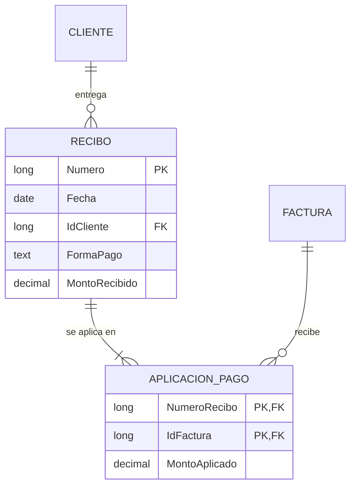

# Sesión 1 · Del papel a los datos

El momento clave llega cuando el grupo descubre que el total de la factura no se guarda: se calcula.

## Agenda (120 min)

| Minutos | Actividad | Notas |
| --- | --- | --- |
| 0–10 | Presentación del curso y del hilo evolutivo | Proyecta la factura 1001 |
| 10–35 | Parte A: análisis de la factura | 10 min individual, 15 en parejas |
| 35–55 | Parte B: carpeta local, seguridad y Base nueva | Verifica Firebird integrado en cada equipo |
| 55–70 | Parte C: recorrido por la interfaz | Demostración en el proyector |
| 70–95 | Parte D: modelo entidad-relación en Mermaid | Dos parejas muestran su diagrama |
| 95–110 | Puesta en común | Entidad, atributo, registro, dato calculado |
| 110–120 | Tarea 1 y autoevaluación | |

## Guion

- Abre con una pregunta: «¿Cuántos datos distintos hay en esta factura?». Suelen contar entre 20 y 25.
- Provoca: «¿Guardamos el total?». Deja que alguien diga sí y pregunta qué pasa si se corrige una cantidad.
- Los datos del emisor anticipan la tabla de parámetros de la sesión 4: un registro único que se repite en todas las facturas.

## Preguntas para la discusión

| Pregunta | Respuesta esperada |
| --- | --- |
| ¿El emisor es una entidad? | Sí, pero con un solo registro: irá a `tblParametros` |
| ¿La descripción del producto pertenece a la línea? | No: depende del producto; la línea solo lo referencia |
| ¿Qué identifica a una línea? | La factura más el producto |

## Preparación del aula

- Verifica LibreOffice con Base en Windows, macOS o Linux. Selecciona Firebird integrado al crear el `.odb`; una conexión de solo lectura a CSV no sirve para estos ejercicios.
- Para los asistentes y el Diseñador de informes, instala y selecciona un JRE compatible con la arquitectura de LibreOffice en Preferencias/Opciones → LibreOffice → Avanzado. Comprueba especialmente equipos ARM y la arquitectura del JRE.
- Distribuye el kit UTF-8 en una carpeta local `CursoED` con `datos` y `basic`. Configura la confianza de esa carpeta siguiendo las políticas de la institución; no reduzcas globalmente la seguridad de macros.
- El estudiante construye su base desde cero; `ConstruirSolucion` es apoyo del instructor y no sustituye las sesiones 2–5.

## Errores frecuentes

| Síntoma | Causa | Solución |
| --- | --- | --- |
| No aparece Base o Firebird integrado | Instalación incompleta o motor distinto | Completar la instalación del aula y seleccionar Firebird integrado |
| Macros bloqueadas | Carpeta no confiable o política institucional | Revisar ubicación de confianza y reabrir; coordinar con TI si es administrada |
| Asistente o informe no abre | Falta un JRE seleccionado y compatible | Verificar LibreOffice → Avanzado y reiniciar LibreOffice si hace falta |
| Base creada fuera de CursoED | No se eligió carpeta al guardar | Guardar en la carpeta local acordada y verificar la ruta |
| Copia de seguridad no conserva el último cambio | Se copió el `.odb` con la base abierta | Guardar, cerrar todos sus documentos, cerrar Base y copiar |
| Mermaid marca error | Nombres de entidad con espacios o sintaxis incompleta | Usar `LINEA_FACTURA` y revisar cardinalidades |

## Solución de la tarea 1

Entidades: Cliente, Recibo, Factura y Aplicación de pago. Un recibo cubre varias facturas y una factura puede pagarse con varios recibos: la relación muchos a muchos se resuelve con Aplicación de pago, que guarda el monto aplicado.

Datos calculados: el saldo pendiente de cada factura. Regla que vale la pena señalar: la suma de los montos aplicados debe igualar el monto recibido.

## Respuestas de la autoevaluación

1. Es un dato derivado: si cambia una cantidad, un total guardado queda inconsistente.
2. La entidad es el tipo de cosa (Cliente); el registro es una ocurrencia (el cliente 1).
3. Firebird almacena y protege datos; Base reúne objetos y conexiones; el formulario Writer contiene controles ligados a un conjunto de filas. La confianza del documento afecta la ejecución de las macros.
4. Cada factura tiene exactamente un cliente; un cliente tiene cero o muchas facturas.
