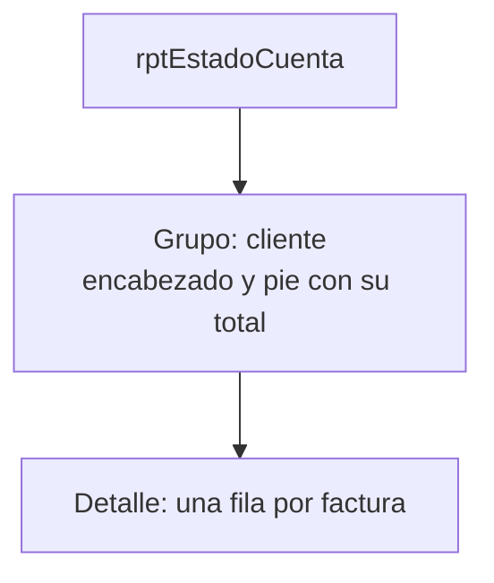

# Sesión 5 · Maestro-detalle e informe

El momento clave está al final: el grupo rompe dos reglas de negocio, y esa experiencia motiva las sesiones 7–8.

## Agenda (120 min)

| Minutos | Actividad | Notas |
| --- | --- | --- |
| 0–10 | Factura como árbol y conjuntos de datos | Encabezado, detalle y resultados de lectura |
| 10–30 | Parte A: formulario maestro–detalle | Asistente y Navegador de formularios |
| 30–50 | Parte B: listas y vistas calculadas | Mostrar nombre primero, almacenar ID segundo |
| 50–80 | Parte C: eventos Basic/UNO | Origen de evento, búfer de fila, guardar y refrescar |
| 80–100 | Parte D: informe | Agrupar antes de mover campos |
| 100–110 | Parte E: factura actual | Comprobar primero filtro manual y luego botón |
| 110–120 | Parte F y tarea 5 | Restaurar pruebas; no omitir el puente hacia objetos |

## Preparación

En un equipo del aula, construye y ejecuta el formulario y reporte siguiendo la guía: los asistentes, la disponibilidad de Java y las etiquetas de eventos dependen de instalación. Registra la versión. Prepara un diseño de demostración del instructor si hace falta recuperar a una pareja; cada estudiante debe comprender y entregar sus vínculos y eventos.

El documento se llama `frmFacturas`; dentro sus modelos son `fFactura`, `sfDetalle`, `sfTotales` y `sfImportes`. El código del ejercicio `modInterfaz` usa esos nombres exactos y la biblioteca Standard. Necesita `modEstructuras` del kit para `ConexionBase`; no requiere ejecutar el constructor ni la solución del dominio.

## Guion

- Los formularios son modelos de datos dentro de Writer; la página por sí sola no guarda una factura. El Navegador revela a qué modelo pertenece cada control.
- La lista SQL tiene texto visible en la primera columna e ID en la segunda. Campo ligado 1 es un índice desde cero; no apliques una propiedad de ancho de columnas de otro producto.
- El evento de una columna de cuadrícula y el de un botón pueden traer orígenes diferentes. `FormularioDelControl` recorre los padres hasta el objeto de fila. No uses un nombre de procedimiento como prueba de que esté asociado a un evento.
- El código de precio y tasa consulta la conexión del formulario sin cambiar su modo de transacción. Primero se modifica un búfer, luego se persiste y después se refrescan vistas. Los repositorios transaccionales de la sesión 8 usan una conexión aislada propia.
- El informe recibe totales repetidos en cada línea: mostrar una vez en el pie, nunca sumar esos totales. Una vista para estado de cuenta, en cambio, lleva una fila por factura y sí se puede agregar.
- Cierra con «¿Quién impide editar una factura Pagada?». El formulario todavía accede directamente a tablas. La integridad de claves y dominios no expresa por sí sola el ciclo de vida del documento.

## Preguntas para la discusión

| Pregunta | Respuesta esperada |
| --- | --- |
| ¿Qué hace el vínculo maestro/esclavo? | Filtra hijos por IdFactura y vincula los nuevos al padre guardado |
| ¿Por qué no guardar en qryTotalesFactura? | Es una vista calculada de lectura; la captura corresponde a las tablas |
| ¿Por qué se consulta el precio por ID? | La lista guarda la referencia; precio es una copia histórica de la venta |
| ¿Por qué no recargar antes de guardar? | El resultado SQL no ve una fila todavía pendiente en el formulario |
| ¿Qué aporta CROSS JOIN con parámetros? | Añade los datos de la única empresa a cada línea; con cero filas da vacío |
| ¿Cuál es el ID para imprimir la factura 1003? | 3 en el conjunto de ejemplo; número comercial e ID interno son distintos |
| ¿Qué cambia al generar el informe? | Se crea una instantánea Writer; posteriores cambios requieren generar otra |

## Errores frecuentes

| Síntoma | Causa | Solución |
| --- | --- | --- |
| La lista guarda 0 o 1 en vez del ID | Campo ligado o tipo de lista incorrecto | SQL texto primero/ID segundo, Campo ligado 1, Campo de datos correcto |
| Selección de producto no copia precio | Evento sin macro o columna pertenece a otro modelo | Revisar Después de actualizar, lstProducto y sfDetalle |
| Nueva factura conserva la tasa inicial del SQL | Evento de restablecer no asignado o no se ejecutó al entrar a la fila nueva | Verificar evento del modelo fFactura, no del control TasaImpuesto |
| Tasa histórica se modificó al navegar | Se quitó la condición IsNew | Restituirla y restaurar datos desde copia de clase |
| Totales siguen anteriores | Captura sin guardar o subformulario no recargado | Guardar y actualizar; revisar restricciones y nombres de subformularios |
| Error al cargar sfTotales | Se eligió Consulta cuando es una vista del motor | Tipo Tabla, contenido qryTotalesFactura |
| No se guarda una línea nueva | Padre sin ID o clave duplicada producto–factura | Guardar encabezado y comprobar vínculo; modelo no permite repetir producto |
| Informe duplicado por cada línea | Totales sumados en pie | Mostrar campos directos una vez; no SUM(Total) sobre vista de impresión |
| Diseñador de informes no abre | Java ausente o incompatible | Comprobar JRE y arquitectura seleccionada en LibreOffice → Avanzado |
| Informe vacío | No hay líneas o falta la única fila de parámetros | Verificar fuente SQL y tblParametros; una factura sin líneas queda fuera por diseño |
| Botón genera todas las facturas | No se estableció Filter en ReportDefinition | Probar filtro manual, luego comprobar código e ID actual |
| Botón pide guardar el diseño de reporte | Diseñador abierto con cambios previos | Guardar y cerrar antes de ejecutar; conservar/restaurar filtro temporal |
| Página desbordada | Controles muy anchos o altos | Ajustar papel, márgenes y detalle en diseñador; revisar Writer generado |

## Solución de la tarea 5

Fuente de `rptEstadoCuenta`: vista `qryTotalesFactura`. Filtro de informe:

```sql
"Estado" IN ('Emitida', 'Pagada')
```

Grupo por `RazonSocial`; detalle con `NumeroFactura`, `Fecha`, `Estado`, `Total`. Para el total del cliente, selecciona un campo de informe en el pie del grupo: Datos → Tipo de campo **Función**, Campo de datos `Total`, Función **Acumulación**, Ámbito el grupo `RazonSocial` (el Diseñador puede crear la función de suma automáticamente). También se acepta un informe maestro–detalle que tome el total ya agregado de `qryVentasPorCliente`, siempre que los estudiantes justifiquen sus fuentes.

Totales esperados: Escuela Técnica Horizonte 38,715.00; Consultores Andinos 10,610.17; Clínica Dental Sonrisas 4,587.57; Papelería El Estudiante 3,873.24 en dos facturas. Suma de clientes 57,785.98. Se excluyen Anulada y Borrador.



Reglas ausentes: no modificar una factura emitida/pagada y no emitir sin líneas. Pertenecen a la factura como objeto del dominio en las sesiones siguientes. En una aplicación de producción también se controla el acceso a tablas y se agregan defensas del servidor; impedir un botón no impide por sí solo una edición directa de tabla.

## Respuestas de la autoevaluación

1. IdFactura: cada línea referencia su encabezado.
2. Muestra RazonSocial y guarda IdCliente, segunda columna con índice 1.
3. Conserva el precio histórico pactado aunque cambie el catálogo.
4. Encabezado del grupo, cada detalle, pie del grupo.
